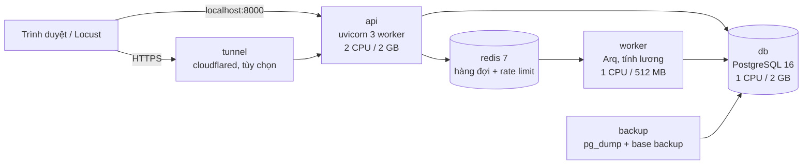

# Chấm công và tính lương: demo chịu tải

Đây là web chấm công và tính lương dùng dữ liệu giả, viết bằng FastAPI, PostgreSQL và Redis, chạy hoàn toàn trong Docker Compose. Mục tiêu không phải là tính năng, mà là chứng minh hệ thống chịu được khoảng 100 request đồng thời và chỉ ra giới hạn thật nằm ở đâu bằng số đo. Kèm theo là một bộ load test dùng lại được cho dự án khác, các mẫu chống tranh chấp dữ liệu (NV-1 đến NV-6) và hai lớp sao lưu có script diễn tập.

Toàn bộ dữ liệu là dữ liệu giả sinh bằng `scripts/seed.py`. Không dùng dữ liệu thật ở bất kỳ đâu.

## Kiến trúc



Dạng ASCII:

```
 trình duyệt / Locust
        |
   [tunnel]  (profile "tunnel", mặc định tắt)
        |
      [api]  uvicorn 3 worker ---> [db] PostgreSQL 16  <--- [backup] dump + base backup
        |                            ^
        v                            |
     [redis] <--- [worker] Arq ------+
```

Chi tiết từng lớp và lý do thiết kế nằm ở `docs/07-kien-truc-va-thiet-ke.md`.

## Chạy nhanh

Yêu cầu: Windows 11 + WSL2 + Docker Desktop, repo nằm trong filesystem WSL (xem `docs/01-cai-dat-va-chay.md`).

```bash
cp .env.example .env                                   # rồi sửa 3 giá trị đổi-tôi: mật khẩu DB, JWT_SECRET, SEED_PASSWORD
docker compose up -d --build                           # api tự chạy migration khi khởi động
docker compose exec api python -m scripts.seed         # 300 nhân viên giả, khoảng 3 tháng chấm công
# mở http://localhost:8000 , đăng nhập mã E0001 (admin) với mật khẩu SEED_PASSWORD trong .env
docker compose run --rm api pytest -q                  # chạy test
./loadtest/run.sh steady                               # đo thử, kết quả ở loadtest/results/
```

## Kết quả load test

Chạy trong mạng Docker (bắn thẳng `http://api:8000`), giới hạn: api 2 CPU, db 1 CPU. Mục tiêu: p95 dưới 500 ms, lỗi dưới 1%.

| Kịch bản | Tải | RPS | p95 | % lỗi | Kết quả |
|---|---|---|---|---|---|
| `steady` | 100 user, nghỉ 1–3 giây | 52 | 16 ms | 0 | **ĐẠT** |
| `ramp` | 50 → 300 user, có nghỉ | 155 | 39 ms ở mức 300 user | 0 | **ĐẠT**, chưa gãy |
| `ramp` kéo dài | 100 → 1000 user, có nghỉ | 176 | 1.700 ms ở mức 400 user | 1,6% (503) ở mức 600 user | Gãy ở 400 user |
| `burst` | 100 request liên tục cùng lúc | 215 | 1.300 ms | 0 | Không đạt |
| `write_storm` | 100 lệnh ghi liên tục cùng lúc | 236 | 1.000 ms | 0 | Không đạt |
| `write_ramp` | 50 → 100 lệnh ghi cùng lúc | 229 | 390 ms ở 50 user, 1.000 ms ở 100 user | 0 | Đạt tới 50, gãy ở 100 |
| `login_storm` | 100 người đăng nhập liên tục | 29 lần/giây | 5.100 ms | 0 | Không đạt (băm mật khẩu cố ý tốn CPU) |

- **Đối soát ghi:** 74.467 lệnh ghi được xác nhận, **0 mất, 0 trùng**.
- **Điểm nghẽn:**
  - Thứ nhất là CPU của api: khoảng 9 ms CPU Python cho mỗi lệnh ghi.
  - Thứ hai là CPU của db và việc chờ ghi WAL xuống đĩa: 70–80% session phải chờ. Đây là cái giá có chủ ý để không mất request.
- **Tăng tài nguyên lên api 3 CPU và db 2 CPU:** ghi ở mức 100 user tăng 20% (281 request/giây, p95 830 ms).
- **Diễn tập sao lưu:** PITR khôi phục trong khoảng 18 giây, dump khoảng 3 giây.

Chi tiết, nhật ký tìm và sửa lỗi, và cách đo lại: [`docs/08-ket-qua-do.md`](docs/08-ket-qua-do.md). Báo cáo gốc của từng lượt: [`docs/ket-qua/`](docs/ket-qua/).

Đổi cấu hình hoặc đọc cách hiểu từng biểu đồ ở `docs/02-load-test.md`.

## Cấu trúc thư mục

```
app/
  core/          cấu hình, DB engine, bảo mật (JWT, argon2), rate limit, xử lý lỗi 503, middleware
  modules/       employees, attendance, requests, payroll (router, service, repository, schemas, models)
  workers/       Arq: job tính lương
  static/        giao diện HTML + JS thuần
  main.py
migrations/      Alembic (0001 schema, 0002 trigger chỉ-insert, 0003 idempotency cho đơn)
scripts/
  seed.py        sinh dữ liệu giả
  init-db.sql    tạo DB chamcong_test cho pytest
  backup/        sao lưu, khôi phục, PITR, diễn tập
loadtest/        locustfile.py, shapes.py, config.env, run.sh, report.py, reconcile.py, sample/, results/
tests/           pytest (NV-1 đến NV-6, phân quyền, ghi an toàn)
docs/            hướng dẫn chi tiết
docker-compose.yml, Dockerfile, .env.example
```

## Mục lục tài liệu

| File | Nội dung |
|---|---|
| [docs/01-cai-dat-va-chay.md](docs/01-cai-dat-va-chay.md) | Cài đặt, biến môi trường, seed, chạy test, lỗi thường gặp |
| [docs/02-load-test.md](docs/02-load-test.md) | Các kịch bản, cấu hình, cách đọc báo cáo, chạy qua tunnel |
| [docs/03-ap-dung-cho-du-an-khac.md](docs/03-ap-dung-cho-du-an-khac.md) | Checklist áp bộ load test sang dự án khác, bảng triệu chứng và cách xử lý |
| [docs/04-thiet-ke-dong-thoi.md](docs/04-thiet-ke-dong-thoi.md) | NV-1 đến NV-6, chống mất request, các mẫu mang sang dự án khác |
| [docs/05-kich-ban-demo.md](docs/05-kich-ban-demo.md) | Kịch bản demo 15 phút và câu hỏi thường gặp |
| [docs/06-sao-luu-khoi-phuc.md](docs/06-sao-luu-khoi-phuc.md) | Sao lưu hai lớp, khôi phục, PITR, sự cố mẫu |
| [docs/07-kien-truc-va-thiet-ke.md](docs/07-kien-truc-va-thiet-ke.md) | Quyết định thiết kế (ADR), nguồn tham khảo, đường lên production |
| [docs/08-ket-qua-do.md](docs/08-ket-qua-do.md) | Kết quả đo, điểm nghẽn, nhật ký tìm và sửa, cách đo lại |

## Ghi chú về dữ liệu giả và quy tắc tính lương mẫu

- 300 nhân viên giả, mã `E0001` đến `E0300`, 5 phòng ban. `E0001` là admin, `E0002` và `E0003` là hr, `E0004` đến `E0013` là manager (mỗi phòng 2 người), còn lại là employee. Tất cả dùng chung mật khẩu `SEED_PASSWORD` trong `.env`.
- Quy tắc tính lương dưới đây là giá trị mẫu để demo, **cần kế toán xác nhận** trước khi dùng thật. Chúng nằm trong bảng `payroll_rules` (JSONB), không nằm cứng trong code:
  - Lương theo công = lương cơ bản x số ngày công / 26.
  - Tiền OT = lương giờ x 150%, với lương giờ = lương cơ bản / 26 / 8.
  - BHXH 8%, BHYT 1,5%, BHTN 1%, tính trên lương cơ bản.
  - Giảm trừ bản thân 15.500.000 đ, mỗi người phụ thuộc 6.200.000 đ.
  - Thuế TNCN lũy tiến mẫu 5 bậc: 5% đến 10 triệu, 10% đến 30 triệu, 20% đến 60 triệu, 30% đến 100 triệu, 35% phần trên 100 triệu.
- Tiền lưu dạng số nguyên (VND), thời gian lưu `timestamptz`, ngày công tính theo `Asia/Ho_Chi_Minh`.

## Lưu ý vận hành

- `.env` trên máy demo đang đặt `RATE_LIMIT_ENABLED=false` để chạy load test (một user test sẽ chạm trần 600 lệnh ghi mỗi phút). Khi demo công khai qua tunnel, đặt lại `RATE_LIMIT_ENABLED=true` rồi chạy `docker compose up -d --no-deps api`.
- Tunnel là public ra internet. Chỉ bật khi cần và tắt ngay sau đó (xem `docs/02-load-test.md`).
- `.env` không bao giờ được commit.
