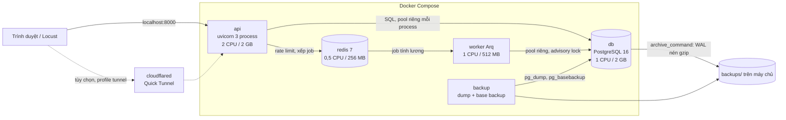
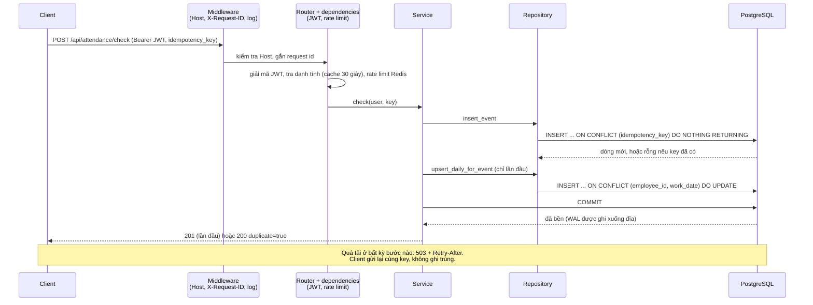

# 07. Kiến trúc và quyết định thiết kế

Tài liệu này mô tả hệ thống được ghép lại như thế nào, vì sao chọn như vậy, và nếu lên production thì cần thêm gì. Các quyết định viết theo dạng ADR ngắn (bối cảnh, quyết định, đánh đổi). Các số đo trong tài liệu có ghi nguồn. Kết quả đo đầy đủ nằm ở `docs/08-ket-qua-do.md`.

## 1. Sơ đồ

### Thành phần

### Luồng một lệnh ghi đi qua các lớp

Ví dụ `POST /api/attendance/check` (chấm công):

Phân tầng trong code: router chỉ validate và gọi service; service chứa nghiệp vụ và quyết định commit hoặc rollback; repository chỉ chạy câu truy vấn. Module này không truy vấn trực tiếp bảng của module khác mà đi qua service của module đó (ví dụ `requests` gọi `employees.service.department_ids`).

Chia CPU trong demo: api 2, db 1, worker 1, redis 0,5, locust 1, backup 0,5 (tổng giới hạn 6 CPU), nên máy cần từ 8 nhân luận lý để các giới hạn không tranh nhau (xem `docs/01-cai-dat-va-chay.md`).

## 2. Các quyết định thiết kế (ADR)

### ADR-1. Chia worker và ngân sách kết nối

- **Bối cảnh:** api có 2 CPU. Python async cần nhiều process để dùng hết số nhân, nhưng mỗi process giữ pool kết nối riêng, còn Postgres có trần `max_connections=100` và mỗi kết nối tốn RAM.
- **Quyết định:** 3 process uvicorn (`UVICORN_WORKERS=3`), mỗi process pool 10 + overflow 5. Worker nền Arq có pool riêng nhỏ (2 kết nối, tối đa 2 job). Chừa 10 kết nối cho psql, backup, probe. Khi khởi động, api cộng lại và ghi WARNING nếu vượt `max_connections`. Với mặc định: `3 x 15 + 2 x 2 + 10 = 59`.
- **Đánh đổi:** nhiều process hơn thì dùng CPU tốt hơn nhưng nhân số kết nối lên. Pool lớn không làm nhanh hơn mà dời hàng đợi vào trong DB. Muốn nhiều process hơn nữa thì cần bộ gộp kết nối (xem "Đường lên production").

### ADR-2. Xác thực: JWT 12 giờ, cache 30 giây, argon2id mức tối thiểu OWASP

- **Bối cảnh:** đăng nhập băm mật khẩu cố ý tốn CPU và RAM. Lần đo đầu cho thấy `login_storm` làm hết pool kết nối (login giữ kết nối trong lúc hash) và hết RAM (khoảng 36 hash song song, mỗi hash 64 MiB). Sau đó mỗi request có xác thực còn phải tra danh tính trong DB.
- **Quyết định:**
  - JWT HS256 sống 12 giờ (`JWT_EXPIRE_HOURS`), để người dùng không phải đăng nhập lại trong một ca.
  - Hash bằng argon2id với tham số tối thiểu theo OWASP Password Storage Cheat Sheet: 19 MiB, 2 vòng, 1 lane. Đo trong container: mỗi lần xác minh giảm từ **150,5 ms xuống 37,7 ms** so với tham số mặc định cũ (64 MiB). Hash cũ vẫn xác minh được vì tham số nằm trong chuỗi hash.
  - Trả kết nối DB về pool **trước** khi băm. Băm chạy trên một thread pool riêng với số hash đồng thời giới hạn (`HASH_CONCURRENCY=2` mỗi process) và hàng chờ tối đa `LOGIN_MAX_WAITING=200`; đầy thì 503 kèm `Retry-After`.
  - Cache tra danh tính trong từng process, TTL 30 giây (`AUTH_CACHE_TTL_SECONDS`), tối đa 10.000 mục. PATCH hồ sơ xóa mục tương ứng.
  - Khi mã nhân viên không tồn tại, vẫn băm một chuỗi giả để thời gian phản hồi không lộ mã nào có thật.
- **Đánh đổi:** cache 30 giây nghĩa là nhân viên vừa nghỉ việc có thể dùng token còn hạn thêm tối đa 30 giây trên process đã cache (đặt TTL 0 để tắt). Token 12 giờ khó thu hồi sớm. Hạ tham số hash còn thấp hơn mức tối thiểu OWASP sẽ nhanh hơn nhưng không chấp nhận được. Giới hạn `login_storm` trên 2 CPU vẫn là giới hạn thật và được ghi nhận trong báo cáo. Số đo hiện tại: 29 lần đăng nhập mỗi giây, p95 5,1 giây, 0 lỗi, RAM api 367 MiB (trước khi sửa: 48% lỗi 500, RAM 2.043 MiB).

### ADR-3. Timeout fail-fast

- **Bối cảnh:** khi quá tải, request xếp hàng chờ vô hạn làm độ trễ tăng cho mọi người và giữ kết nối, khiến tình hình tệ hơn. Hệ thống tài chính chọn lỗi nhanh có kiểm soát thay vì chờ.
- **Quyết định:** đặt timeout ở mức từng kết nối của ứng dụng (không đặt chung trong `postgresql.conf`): `statement_timeout=5000 ms`, `lock_timeout=2000 ms`, `idle_in_transaction_session_timeout=10000 ms`, cùng `pool_timeout=10 s` cho việc lấy kết nối từ pool. Job nền dùng cấu hình riêng (timeout dài theo `PAYROLL_JOB_TIMEOUT`, không đặt `lock_timeout`) vì nó chờ khóa và chạy lệnh lớn có chủ đích.
- **Đánh đổi:** một số request hợp lệ nhưng chậm sẽ bị cắt và trả 503; client phải thử lại. Đổi lại, hệ thống không bị nghẽn dây chuyền, và transaction bỏ dở không giữ khóa hay chặn VACUUM. Nguồn: tài liệu PostgreSQL nói các timeout mặc định là 0 (tắt), không nên đặt chung toàn cục mà nên đặt theo từng kết nối của ứng dụng, và transaction idle lâu làm chặn VACUUM (https://www.postgresql.org/docs/current/runtime-config-client.html).

### ADR-4. 503 và 429 kèm `Retry-After`

- **Bối cảnh:** lỗi 500 trần không cho client biết có nên thử lại hay không, nên client hoặc bỏ cuộc (mất request) hoặc thử dồn dập (làm tệ thêm).
- **Quyết định:** mọi lỗi tạm thời đều quy về 503 kèm `Retry-After` (mặc định 2 giây, `RETRY_AFTER_SECONDS`): hết pool, `statement_timeout`, `lock_timeout`, hết kết nối Postgres, Postgres đang khởi động hoặc tắt, Redis mất kết nối, hàng đợi băm đầy. Lỗi chuỗi hóa và deadlock được service tự thử lại tối đa 3 lần trước khi trả 503. Lỗi DB không rõ nguyên nhân vẫn là 500 (để không che lỗi thật). Rate limit trả 429 kèm số giây còn lại của cửa sổ. Mọi response có `X-Request-ID`, và 503 được ghi log kèm id đó.
- **Đánh đổi:** client phải biết thử lại (và các lệnh ghi phải idempotent, xem ADR-5). Cần phân loại lỗi cẩn thận để không biến lỗi lập trình thành 503. Code: `app/core/errors.py`.

### ADR-5. Idempotency theo kiểu Stripe

- **Bối cảnh:** thử lại là cách duy nhất để không mất request khi gặp lỗi tạm thời, nhưng thử lại mà không có idempotency thì sinh bản ghi trùng.
- **Quyết định:** mọi lệnh ghi đều an toàn khi gửi lại (chi tiết ở `docs/04-thiet-ke-dong-thoi.md`). Với chấm công và tạo đơn, client gửi một UUID và DB có ràng buộc `UNIQUE` trên đó. Gửi lại cùng key thì trả lại kết quả cũ. Nếu cùng key mà **tham số khác** thì báo lỗi 422, vì đó là lỗi của client chứ không phải thử lại. Key của người khác thì 409, không lộ dữ liệu.
- **Đánh đổi:** so với Stripe, demo không lưu lại nguyên response mà dựng lại từ bản ghi, và không hết hạn key (lưu vĩnh viễn cùng bản ghi nên bảng lớn dần). Stripe lưu status code và body của lần đầu (kể cả khi lỗi 500), cho phép dọn key sau ít nhất 24 giờ (https://docs.stripe.com/api/idempotent_requests). Muốn dọn key thì phải thêm cột thời gian và job dọn.

### ADR-6. Rate limit

- **Bối cảnh:** chống một client (hoặc script lỗi) làm cạn tài nguyên; chống dò mật khẩu.
- **Quyết định:** cửa sổ cố định 60 giây trong Redis, một script Lua làm `INCR` và `EXPIRE` nguyên tử trong một vòng đi về. Đăng nhập: 20 lần mỗi phút theo mã nhân viên (`RATE_LOGIN_PER_MIN`). Ghi: 600 lệnh mỗi phút theo user (`RATE_WRITE_PER_MIN`). Redis lỗi thì mặc định cho request đi qua (**fail-open**, `RATE_LIMIT_FAIL_OPEN=true`) và ghi log; đặt `false` để trả 503.
- **Đánh đổi:** cửa sổ cố định cho phép dồn gấp đôi ở ranh giới hai cửa sổ; token bucket mượt hơn. Fail-open ưu tiên khả năng dùng được hơn khả năng bảo vệ. Stripe cũng dùng token bucket trên Redis, fail-open (https://stripe.com/blog/rate-limiters). Khi load test phải tắt (`RATE_LIMIT_ENABLED=false`), khi demo công khai phải bật lại.

### ADR-7. Đồng hồ DB

- **Bối cảnh:** ba process api chạy trên cùng một máy nên đồng hồ gần như trùng, nhưng khi có nhiều máy thì lệch đồng hồ làm thứ tự sự kiện sai. Thời điểm chấm công là dữ liệu quan trọng.
- **Quyết định:** thời điểm sự kiện chấm công lấy từ `now()` của PostgreSQL (`event_time=None` trong `insert_event`), cũng như `decided_at` và `calculating_started_at`. Một nguồn thời gian duy nhất cho mọi process.
- **Đánh đổi:** thời điểm là lúc giao dịch ghi vào DB chứ không phải lúc người dùng bấm. Nếu request bị trễ thì giờ ghi trễ theo. Có thể truyền giờ client rồi kiểm tra độ lệch cho phép, nhưng demo chọn đơn giản.

### ADR-8. Ghi đồng bộ vào DB rồi mới trả lời (không đặt hàng đợi Redis phía trước)

- **Bối cảnh:** có thể giảm độ trễ bằng cách nhận request, đẩy vào hàng đợi Redis, trả "đã nhận" ngay rồi ghi sau. Cách này giúp chịu đỉnh tải nhưng đổi lấy độ tin cậy.
- **Quyết định:** lệnh ghi quan trọng (chấm công, đơn) **commit vào PostgreSQL trước khi trả lời**. Redis chỉ dùng cho rate limit và job nền dài (tính lương), không đứng trước đường ghi.
- **Lý do:** khi client nhận 2xx thì dữ liệu đã nằm trong DB và đã bền (WAL được ghi xuống đĩa với `synchronous_commit` mặc định). Hàng đợi trước DB tạo ra khoảng trống "đã báo thành công mà chưa ghi": Redis chết hoặc mất dữ liệu thì mất request đã được xác nhận, trái với mục tiêu "không mất request". Thêm nữa là sẽ cần đối soát hai nơi, xử lý thứ tự và thông báo lỗi bất đồng bộ cho người dùng.
- **Đánh đổi:** độ trễ ghi bằng thời gian commit của Postgres, và đỉnh tải vượt công suất sẽ bị từ chối (503) chứ không được hấp thụ. Nếu sau này cần hấp thụ đỉnh, thì dùng outbox hoặc hàng đợi **bền** (có xác nhận ghi đĩa) và chấp nhận trả `202 Accepted` kèm cách tra cứu kết quả. LMAX, sàn giao dịch đạt thông lượng rất cao bằng một luồng xử lý tuần tự trong bộ nhớ, event sourcing và phát lại nhật ký khi khởi động lại (khoảng 6 triệu lệnh mỗi giây trên một luồng, theo bài đo trên phần cứng Nehalem 3 GHz), nhưng đó là kiến trúc khác hẳn, không phải thứ có thể thêm vào một ứng dụng CRUD (https://martinfowler.com/articles/lmax.html).

### ADR-9. Hai lớp sao lưu

- **Bối cảnh:** cần khôi phục được khi xóa nhầm, hỏng volume hay mất máy; và cần chứng minh được bằng diễn tập.
- **Quyết định:** lớp 1 là dump logic định kỳ (đơn giản, dễ kiểm tra, mất tối đa khoảng 30 phút). Lớp 2 là base backup cộng lưu trữ WAL liên tục để khôi phục về một thời điểm bất kỳ (PITR), mất tối đa khoảng 5 phút. Có `drill.sh` diễn tập tự động trên stack riêng. Chi tiết ở `docs/06-sao-luu-khoi-phuc.md`.
- **Đánh đổi:** tốn dung lượng và một service chạy nền. `backups/` nằm cùng máy nên chưa chống được mất máy; cần chép ra nơi khác (quy tắc 3-2-1). Chưa có bản sao đồng bộ (RPO bằng 0) vì chưa cần cho demo.

### ADR-10. Tinh chỉnh WAL và checkpoint, giữ nguyên các thiết lập bền

- **Bối cảnh:** tải ghi nặng sinh nhiều WAL và checkpoint dày làm giật độ trễ.
- **Quyết định:** nâng `max_wal_size` lên 2 GB (mặc định 1 GB) và `min_wal_size` 512 MB, `checkpoint_timeout` lên 10 phút (mặc định 5 phút), `checkpoint_completion_target=0.9`, bật `wal_compression` (mặc định tắt), `random_page_cost=1.1` cho đĩa SSD. Bật `pg_stat_statements` và `track_io_timing` để quan sát khi đo. **Không** đụng `fsync`, `synchronous_commit` và `full_page_writes`. Đã cân nhắc nhưng chưa dùng `commit_delay` (mặc định 0): nó chỉ có tác dụng khi số giao dịch đang chạy từ `commit_siblings` (mặc định 5) trở lên, cần đo trước khi bật. Nguồn mặc định và ý nghĩa các tham số: https://www.postgresql.org/docs/current/runtime-config-wal.html.
- **Đánh đổi:** checkpoint thưa hơn thì khôi phục sau sự cố (crash recovery) phải phát lại nhiều WAL hơn, nên thời gian khởi động lại lâu hơn; WAL nén tốn thêm một chút CPU (db chỉ có 1 CPU). Hiệu quả thực tế: khi ghi nặng, 70–80% session của db vẫn phải chờ `WALWrite`/`WALSync`, tức là giới hạn nằm ở việc ghi đĩa chứ không ở checkpoint. Thử thêm group commit (`PG_COMMIT_DELAY=1000`) cũng không thấy lợi rõ: 216 so với 232 request/giây, nằm trong sai số (xem `docs/08-ket-qua-do.md`, mục 5).

## 3. Học từ ngân hàng và sàn giao dịch

Các nguồn dưới đây đã được mở và đọc khi lập tài liệu. Phần "Áp dụng" nói rõ demo đã làm tới đâu.

1. **Stripe, idempotency** (https://docs.stripe.com/api/idempotent_requests): lưu status code và body của lần đầu (kể cả lỗi 500); key tối đa 255 ký tự, khuyến nghị UUIDv4, giữ ít nhất 24 giờ; tham số khác lần gốc thì báo lỗi; request trùng đang chạy song song thì không lưu kết quả. *Áp dụng:* ADR-5, kể cả kiểm tra "cùng key khác tham số thì lỗi" trên `POST /api/requests`. Chưa làm: lưu nguyên response, hết hạn key.
2. **Stripe, rate limiter và load shedder** (https://stripe.com/blog/rate-limiters): bốn lớp: (a) giới hạn tần suất request bằng token bucket trên Redis, fail-open; (b) giới hạn số request đồng thời; (c) fleet usage load shedder, giữ phần dành riêng cho request quan trọng, trả 503; (d) worker utilization load shedder. *Áp dụng:* ADR-6 (một phần của lớp a, bằng cửa sổ cố định). Hàng chờ băm mật khẩu (`LOGIN_MAX_WAITING`) là một dạng giới hạn đồng thời nhỏ. Lớp (b), (c), (d) chưa làm (xem "Đường lên production").
3. **LMAX Architecture, Martin Fowler** (https://martinfowler.com/articles/lmax.html): logic nghiệp vụ chạy trên một luồng, trong bộ nhớ; event sourcing; khôi phục bằng cách phát lại nhật ký; khoảng 6 triệu lệnh mỗi giây trên một luồng (Nehalem 3 GHz), khởi động lại dưới 1 phút. *Áp dụng:* bài học, không phải kiến trúc. Demo giữ PostgreSQL làm nguồn sự thật; ý tưởng "sự kiện chỉ ghi thêm, trạng thái tính lại được" thể hiện ở NV-5 (`attendance_events` chỉ INSERT, `attendance_daily` tính lại được).
4. **Transactional outbox** (https://microservices.io/patterns/data/transactional-outbox.html): ghi message cùng transaction với dữ liệu, một relay gửi sau, bên nhận phải idempotent. *Áp dụng:* chưa cần trong demo, mô tả ở `docs/04-thiet-ke-dong-thoi.md` và ở mục "Đường lên production".
5. **PostgreSQL, độ bền và nhân bản:**
   - `synchronous_commit` (https://www.postgresql.org/docs/current/runtime-config-wal.html): đặt `off` thì có thể mất giao dịch đã báo commit nhưng không làm hỏng nhất quán, và có thể đặt riêng cho từng giao dịch. *Áp dụng:* demo để mặc định (bật).
   - Nhân bản mặc định là bất đồng bộ; muốn đồng bộ thì dùng `synchronous_standby_names` (https://www.postgresql.org/docs/current/warm-standby.html). *Áp dụng:* chưa có bản sao.
   - Patroni (https://patroni.readthedocs.io/en/latest/) dùng để tự động chuyển đổi dự phòng (failover) thông qua một kho cấu hình phân tán (DCS). *Áp dụng:* chưa có.
6. **PgBouncer** (https://www.pgbouncer.org/features.html): ở transaction pooling không dùng được advisory lock mức session, `SET` và `PREPARE` ở mức SQL. Với asyncpg đặt `statement_cache_size=0` (https://magicstack.github.io/asyncpg/current/api/index.html). *Áp dụng:* demo kết nối thẳng DB, xem bên dưới.
7. **Cloudflare Quick Tunnel** (https://developers.cloudflare.com/cloudflare-one/networks/connectors/cloudflare-tunnel/do-more-with-tunnels/trycloudflare/): tối đa 200 request đang xử lý, vượt thì trả 429; không hỗ trợ SSE; không có SLA; chỉ dùng để thử nghiệm. *Áp dụng:* tunnel chỉ để tham khảo, số đo chính trong mạng Docker (`docs/02-load-test.md`).
8. **Mặc định WAL và checkpoint** (https://www.postgresql.org/docs/current/runtime-config-wal.html): `max_wal_size` 1 GB, `checkpoint_timeout` 5 phút, `checkpoint_completion_target` 0.9, `wal_compression` tắt, `commit_delay` 0. *Áp dụng:* ADR-10.
9. **Timeout phía DB** (https://www.postgresql.org/docs/current/runtime-config-client.html): mặc định 0 (tắt); nên đặt theo từng kết nối của ứng dụng; transaction idle lâu chặn VACUUM. *Áp dụng:* ADR-3.

Hai chủ đề dưới đây là kiến thức chung, **chưa gắn nguồn trích dẫn** vì chưa có tài liệu đã xác minh:

- **Sổ cái kép (double-entry ledger):** nguyên tắc chỉ ghi thêm, mỗi bút toán cân nợ và có, không sửa mà ghi bút toán đảo khi sai. Tinh thần này giống NV-5 (bảng chỉ insert), nhưng demo không phải sổ cái tiền.
- **RPO và RTO, phân tầng mức độ quan trọng, multi-AZ:** các khái niệm chuẩn trong thiết kế hệ thống tài chính. Số RPO và RTO của demo được đo bằng diễn tập ở `docs/06-sao-luu-khoi-phuc.md`, không lấy từ tài liệu tham khảo nào.

## 4. Đường lên production (không làm trong demo)

Những thứ dưới đây cần khi dữ liệu thật và tải lớn hơn. Demo cố ý chưa làm; ghi lại để biết hướng đi.

- **Bản sao (replica) và Patroni.** Thêm ít nhất một bản sao streaming để có dự phòng nóng và để đọc báo cáo. Nhân bản mặc định bất đồng bộ (mất được vài giao dịch cuối khi chuyển đổi); muốn RPO bằng 0 thì dùng nhân bản đồng bộ qua `synchronous_standby_names`, đổi lại độ trễ ghi tăng và ghi có thể bị chặn khi bản sao mất. Patroni tự động chọn lại máy chính (failover) qua một kho cấu hình phân tán (etcd, Consul...), cần ít nhất 3 nút cho kho đó.
- **PgBouncer.** Khi cần nhiều process ứng dụng hơn số kết nối Postgres cho phép, đặt PgBouncer ở chế độ transaction pooling: nhiều kết nối ứng dụng dùng chung ít kết nối thật. Lưu ý:
  - `pg_advisory_lock` mức session **không chạy** ở chế độ transaction (khóa gắn với kết nối thật, mà kết nối đó có thể được trao cho client khác). Job tính lương hiện dùng đúng loại khóa này, nên phải kết nối **thẳng** vào Postgres, hoặc đổi sang `pg_advisory_xact_lock` (khóa theo transaction).
  - `SET` và `PREPARE` ở mức SQL cũng không dùng được. Với asyncpg phải đặt `statement_cache_size=0` để không dùng prepared statement.
  - Các timeout đặt theo kết nối (ADR-3) cần chuyển sang cách đặt theo transaction (`SET LOCAL`) hoặc theo role/database.
- **Outbox** nếu cần gửi thông báo (email, tích hợp hệ thống khác) khi có sự kiện: ghi vào bảng `outbox` trong cùng transaction, relay gửi sau, bên nhận idempotent (`docs/04-thiet-ke-dong-thoi.md`).
- **Concurrent limiter và load shedder kiểu Stripe.** Hiện chỉ có rate limit theo thời gian. Thêm: giới hạn số request **đang xử lý** đồng thời mỗi user hoặc mỗi tenant; và load shedder biết ưu tiên: khi tải toàn hệ thống vượt ngưỡng thì loại bỏ trước các request ít quan trọng (đọc báo cáo) để giữ chỗ cho request quan trọng (chấm công, thanh toán), trả 503 kèm `Retry-After`. Mô tả trong https://stripe.com/blog/rate-limiters.
- **Multi-AZ.** Đặt các nút ở những vùng khả dụng (availability zone) khác nhau để một vùng mất điện hay mất mạng không làm sập cả hệ thống. Kèm: sao lưu ở vùng hoặc nhà cung cấp khác, kiểm tra thường xuyên bằng diễn tập, xác định RPO và RTO theo từng mức độ quan trọng của dữ liệu.
- **Khác:** mã hóa cột nhạy cảm (`employee_sensitive`) và sao lưu, quản lý secret ngoài `.env`, thu hồi token (danh sách token bị thu hồi hoặc token ngắn hạn kèm refresh token), giám sát và cảnh báo (p95, tỷ lệ 503, `pg_stat_archiver.failed_count`), và `pg_stat_statements` bật sẵn để tìm truy vấn chậm.

## Bổ sung: trang giám sát trực tiếp và index BRIN

- **Bối cảnh:** load test chạy trong Docker nên người xem không thấy 100 user ở đâu.
- **Quyết định:** thêm `GET /api/monitor/live` (chỉ HR/admin) và trang `monitor.html`, tự làm mới mỗi giây.
  - Mỗi lần gọi chạy 4 câu đọc: tổng và chuỗi theo giây bằng một câu `GROUPING SETS`, 20 lượt mới nhất theo khóa chính, số đơn mới, và tên nhân viên. Mọi câu đi qua service của module sở hữu bảng.
  - Lọc theo khoảng thời gian dùng index **BRIN** trên `attendance_events(event_time)` và `requests(created_at)`. Hai bảng này chỉ thêm dòng và gần như theo thứ tự thời gian, nên BRIN rất nhỏ và gần như không tốn gì khi ghi. B-tree thì sẽ thêm một lần cập nhật index cho mỗi lượt chấm công.
- **Đánh đổi:** mỗi người đang mở trang giám sát tạo thêm khoảng 1 request đọc mỗi giây. Chỉ nên để một vài người xem cùng lúc.

