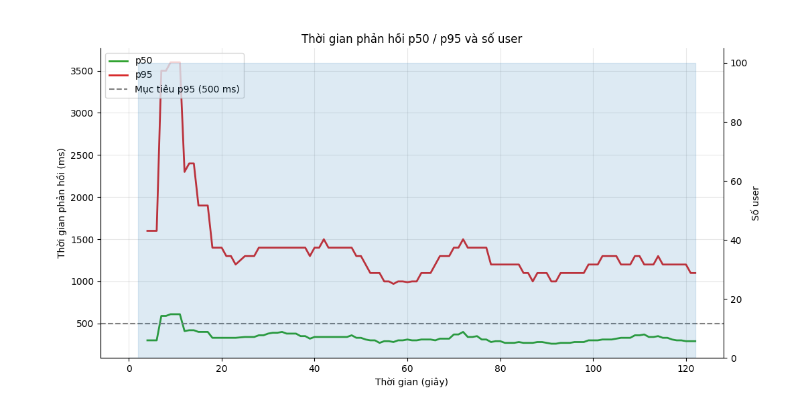
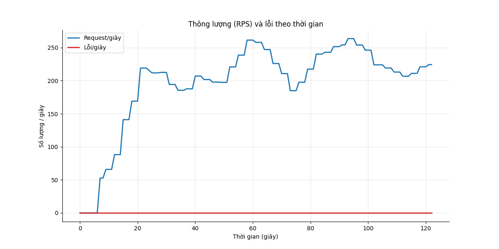
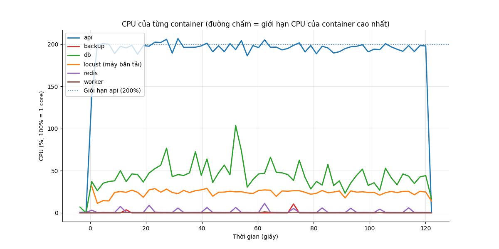
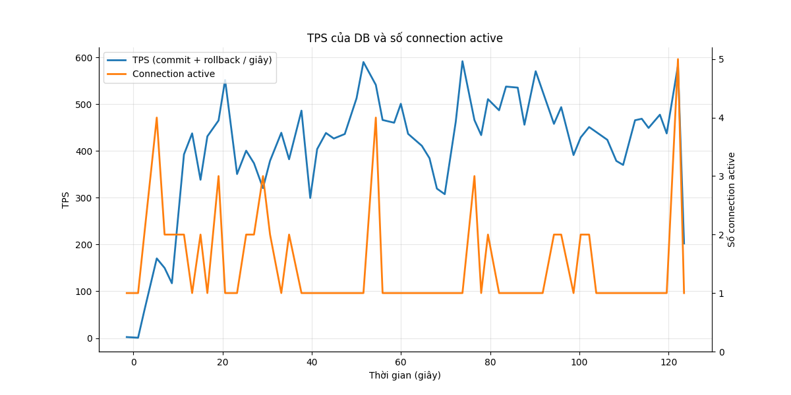

# Báo cáo load test: burst (Dồn dập)

- Địa chỉ bắn: `http://api:8000`
- Thời điểm chạy: 2026-10-26T19:51:07Z (commit `4088646`)
- Tổng số request: 25.931, trung bình 215.1 request/giây
- RATE_LIMIT_ENABLED của api: `false`

## Mục tiêu so với thực tế

| Chỉ số | Mục tiêu | Thực tế | Kết quả |
|---|---|---|---|
| p95 thời gian phản hồi | < 500 ms | 1300 ms | KHÔNG ĐẠT |
| Tỷ lệ lỗi | < 1% | 0.00% | ĐẠT |

**Kết luận: KHÔNG ĐẠT**

## Theo từng endpoint

| Endpoint | Số request | p50 (ms) | p95 (ms) | p99 (ms) | % lỗi |
|---|---|---|---|---|---|
| `POST /api/attendance/check` | 5369 | 240 | 1100 | 1700 | 0.00 |
| `POST /api/attendance/check (duplicate)` | 1713 | 200 | 1100 | 1700 | 0.00 |
| `GET /api/attendance/me` | 8704 | 410 | 1300 | 2000 | 0.00 |
| `POST /api/auth/login` | 100 | 2600 | 6200 | 6600 | 0.00 |
| `GET /api/me` | 3533 | 180 | 1000 | 1900 | 0.00 |
| `POST /api/requests (create)` | 1811 | 230 | 1000 | 1700 | 0.00 |
| `POST /api/requests/[id]/approve` | 597 | 280 | 1100 | 1800 | 0.00 |
| `GET /api/requests/me` | 3505 | 410 | 1300 | 2000 | 0.00 |
| `GET /api/requests?status=pending` | 599 | 420 | 1400 | 2100 | 0.00 |
| **Tổng** | 25931 | 310 | 1300 | 2000 | 0.00 |

## CPU và RAM cao nhất

| Container | CPU cao nhất | Giới hạn CPU | RAM cao nhất | Giới hạn RAM |
|---|---|---|---|---|
| api | 207% | 200% | 365 MiB | 2048 MiB |
| backup | 11% | 50% | 3 MiB | 256 MiB |
| db | 104% | 100% | 221 MiB | 2048 MiB |
| locust (máy bắn tải) | 32% | 200% | 67 MiB | 1024 MiB |
| redis | 11% | 50% | 6 MiB | 256 MiB |
| worker | 1% | 100% | 60 MiB | 512 MiB |

**Điểm nghẽn:** **api** chạm giới hạn CPU (207% / 200%); **db** chạm giới hạn CPU (104% / 100%); **db** nghẽn ghi WAL (23% session chờ WALWrite/WALSync); **app** chậm hơn DB (63% session đang chạy chỉ chờ Client)

## TPS của DB

TPS trung bình 407, cao nhất 592; connection active cao nhất 5. Biểu đồ ở cuối báo cáo.

## DB đang chờ gì

Mỗi 2 giây đếm các session đang chạy theo wait event. Nhiều `Lock` nghĩa là tranh chấp khóa, `LWLock/WALWrite` nghĩa là nghẽn ghi WAL, `Client` nghĩa là app chậm.

| Wait event | Số lần thấy | Tỷ lệ | Ý nghĩa |
|---|---|---|---|
| `Client/ClientRead` | 19 | 63.3% | DB chờ app gửi/nhận (app chậm) |
| `IO/WALSync` | 5 | 16.7% | nghẽn ghi WAL (log giao dịch) |
| `CPU` | 4 | 13.3% | đang chạy CPU, không chờ gì |
| `LWLock/WALWrite` | 2 | 6.7% | nghẽn ghi WAL (log giao dịch) |

## Truy vấn tốn nhất

| Lần gọi | Trung bình (ms) | Tổng (ms) | Số dòng | Câu SQL |
|---|---|---|---|---|
| 7093 | 0.28 | 2009.3 | 5376 | `INSERT INTO attendance_events (employee_id, event_time, source, idempotency_key) VALUES ($1::BIGINT, now(), $2::VARCHAR,` |
| 5376 | 0.25 | 1317.2 | 5376 | `INSERT INTO attendance_daily AS d (employee_id, work_date, first_in, last_out, worked_minutes, ot_minutes) SELECT CAST($` |
| 1816 | 0.57 | 1033.4 | 1816 | `INSERT INTO requests (employee_id, type, work_date, start_at, end_at, reason) VALUES ($1::BIGINT, $2::VARCHAR, $3::DATE,` |
| 8733 | 0.09 | 760.4 | 8733 | `SELECT count(*) AS count_1 FROM attendance_daily WHERE attendance_daily.employee_id = $1::BIGINT` |
| 8733 | 0.08 | 716.5 | 174660 | `SELECT attendance_daily.id, attendance_daily.employee_id, attendance_daily.work_date, attendance_daily.first_in, attenda` |
| 602 | 0.81 | 489.1 | 602 | `SELECT count(*) AS count_1 FROM requests WHERE requests.status = $1::VARCHAR AND requests.employee_id IN (SELECT employe` |
| 602 | 0.59 | 358.2 | 11979 | `SELECT requests.id, requests.employee_id, requests.type, requests.work_date, requests.start_at, requests.end_at, request` |
| 3513 | 0.09 | 329.4 | 33522 | `SELECT requests.id, requests.employee_id, requests.type, requests.work_date, requests.start_at, requests.end_at, request` |
| 599 | 0.46 | 276.8 | 599 | `UPDATE requests SET status=$1::VARCHAR, approved_by=$2::BIGINT, decided_at=now() WHERE requests.id = $3::BIGINT AND requ` |
| 3513 | 0.08 | 265.1 | 3513 | `SELECT count(*) AS count_1 FROM requests WHERE requests.employee_id = $1::BIGINT` |
| 3940 | 0.05 | 190.6 | 3940 | `SELECT employees.id, employees.code, employees.full_name, employees.department, employees.hired_on, employees.left_on, e` |
| 2415 | 0.07 | 160.0 | 2415 | `SELECT payroll_periods.status FROM payroll_periods WHERE payroll_periods.year = $1::INTEGER AND payroll_periods.month = ` |
| 1717 | 0.06 | 97.6 | 1717 | `SELECT attendance_events.id, attendance_events.event_time, attendance_events.employee_id FROM attendance_events WHERE at` |
| 599 | 0.15 | 87.1 | 599 | `SELECT requests.employee_id, requests.work_date, requests.status, requests.approved_by, requests.employee_id IN (SELECT ` |
| 44103 | 0.00 | 83.4 | 0 | `ROLLBACK` |

## Biểu đồ

