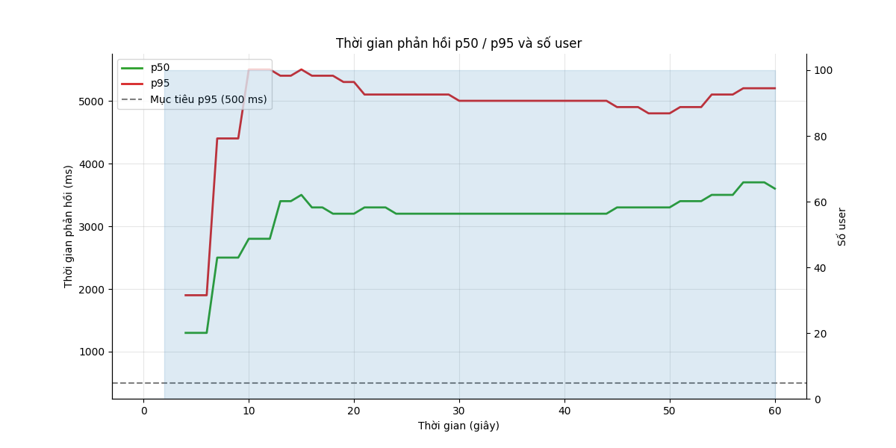
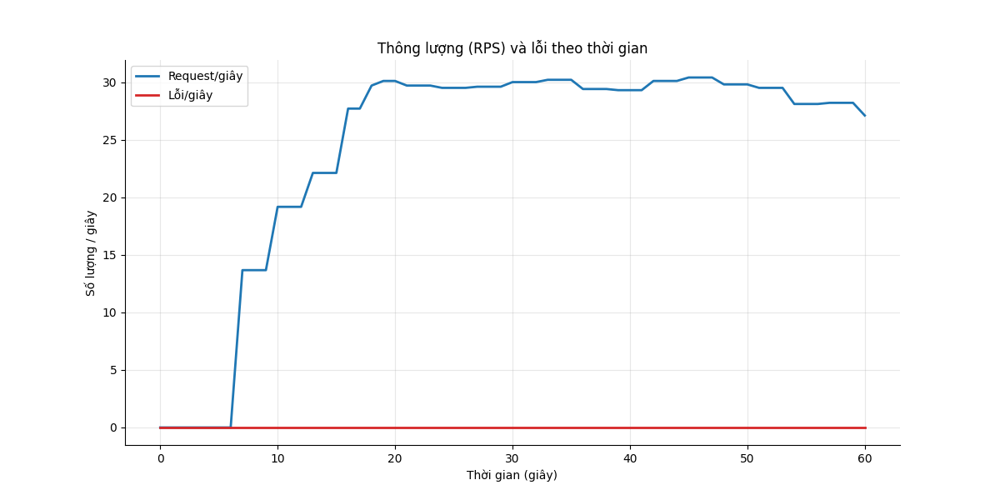
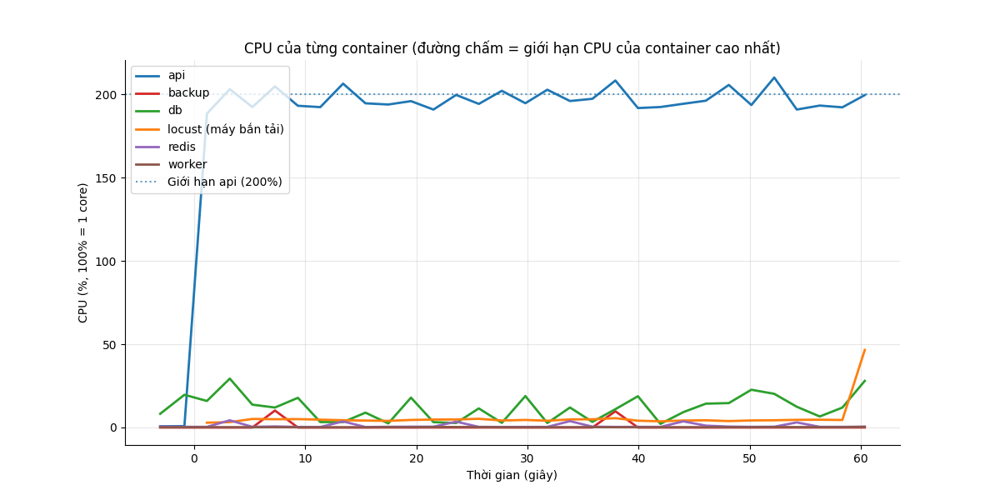
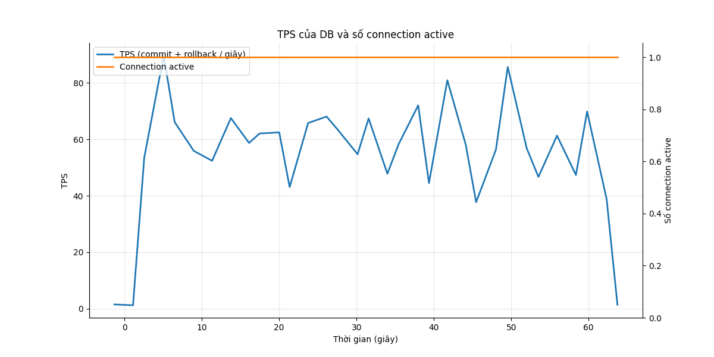

# Báo cáo load test: login_storm (Bão đăng nhập)

- Địa chỉ bắn: `http://api:8000`
- Thời điểm chạy: 2026-10-26T19:58:45Z (commit `4088646`)
- Tổng số request: 1.719, trung bình 28.6 request/giây
- RATE_LIMIT_ENABLED của api: `false`

## Mục tiêu so với thực tế

| Chỉ số | Mục tiêu | Thực tế | Kết quả |
|---|---|---|---|
| p95 thời gian phản hồi | < 500 ms | 5100 ms | KHÔNG ĐẠT |
| Tỷ lệ lỗi | < 1% | 0.00% | ĐẠT |

**Kết luận: KHÔNG ĐẠT**

## Theo từng endpoint

| Endpoint | Số request | p50 (ms) | p95 (ms) | p99 (ms) | % lỗi |
|---|---|---|---|---|---|
| `POST /api/auth/login` | 1719 | 3300 | 5100 | 5400 | 0.00 |
| **Tổng** | 1719 | 3300 | 5100 | 5400 | 0.00 |

## CPU và RAM cao nhất

| Container | CPU cao nhất | Giới hạn CPU | RAM cao nhất | Giới hạn RAM |
|---|---|---|---|---|
| api | 210% | 200% | 367 MiB | 2048 MiB |
| backup | 10% | 50% | 3 MiB | 256 MiB |
| db | 29% | 100% | 177 MiB | 2048 MiB |
| locust (máy bắn tải) | 47% | 200% | 65 MiB | 1024 MiB |
| redis | 4% | 50% | 6 MiB | 256 MiB |
| worker | 0% | 100% | 59 MiB | 512 MiB |

**Điểm nghẽn:** **api** chạm giới hạn CPU (210% / 200%)

## TPS của DB

TPS trung bình 54, cao nhất 90; connection active cao nhất 1. Biểu đồ ở cuối báo cáo.

## DB đang chờ gì

Không có session nào đang chạy trong các mẫu.

## Truy vấn tốn nhất

| Lần gọi | Trung bình (ms) | Tổng (ms) | Số dòng | Câu SQL |
|---|---|---|---|---|
| 1816 | 0.06 | 102.0 | 1816 | `SELECT employees.id, employees.code, employees.full_name, employees.department, employees.hired_on, employees.left_on, e` |
| 3639 | 0.00 | 6.0 | 0 | `BEGIN` |
| 1823 | 0.00 | 3.1 | 0 | `ROLLBACK` |
| 1816 | 0.00 | 2.7 | 0 | `COMMIT` |
| 5 | 0.01 | 0.0 | 5 | `SELECT $1` |
| 1 | 0.01 | 0.0 | 1 | `SELECT now()` |

## Biểu đồ

