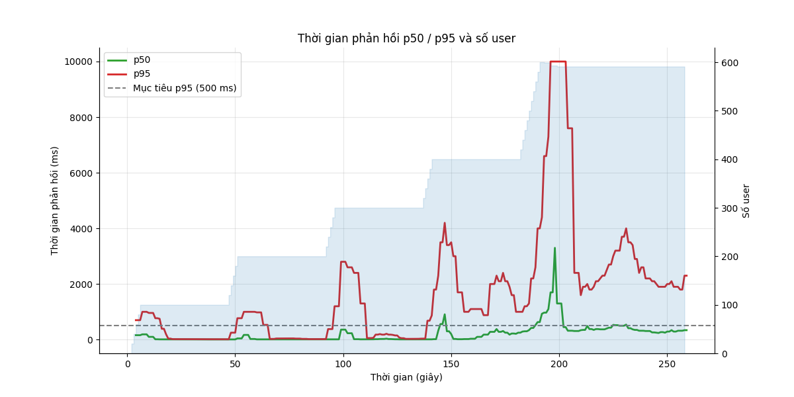
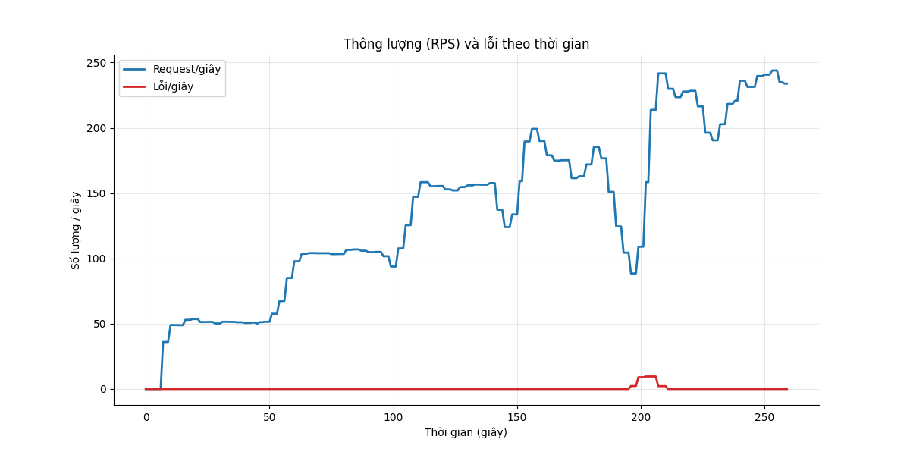
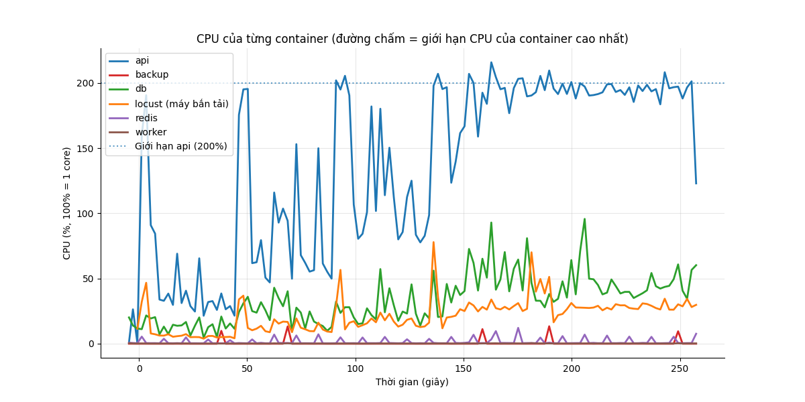
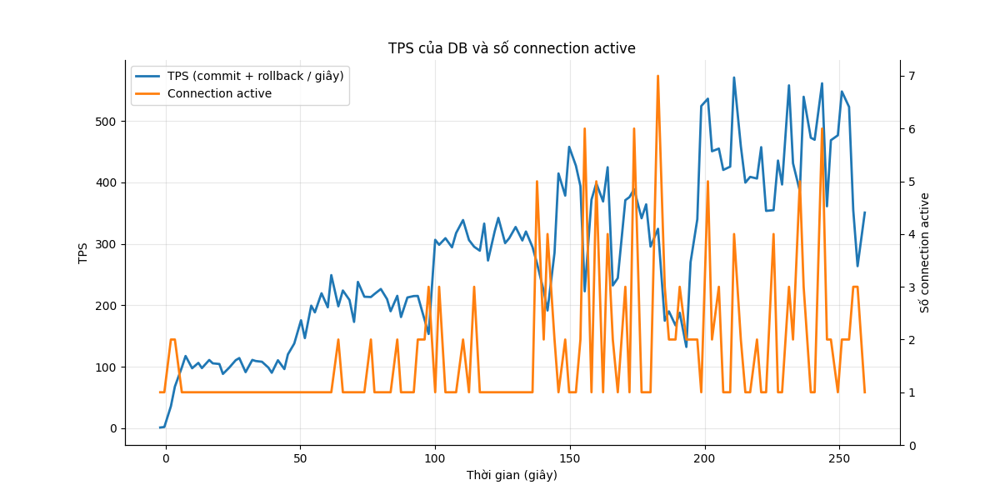

# Báo cáo load test: ramp (Tăng dần)

- Địa chỉ bắn: `http://api:8000`
- Thời điểm chạy: 2026-10-26T20:06:47Z (commit `4088646`)
- Tổng số request: 36.475, trung bình 142.2 request/giây
- RATE_LIMIT_ENABLED của api: `false`

## Mục tiêu so với thực tế

| Chỉ số | Mục tiêu | Thực tế | Kết quả |
|---|---|---|---|
| p95 thời gian phản hồi | < 500 ms | 2300 ms | KHÔNG ĐẠT |
| Tỷ lệ lỗi | < 1% | 0.26% | ĐẠT |

**Kết luận: KHÔNG ĐẠT**

## Theo từng endpoint

| Endpoint | Số request | p50 (ms) | p95 (ms) | p99 (ms) | % lỗi |
|---|---|---|---|---|---|
| `POST /api/attendance/check` | 7010 | 160 | 2000 | 4800 | 0.17 |
| `POST /api/attendance/check (duplicate)` | 2159 | 140 | 2000 | 5000 | 0.28 |
| `GET /api/attendance/me` | 11807 | 200 | 2500 | 5600 | 0.22 |
| `POST /api/auth/login` | 600 | 1200 | 7500 | 10000 | 1.50 |
| `GET /api/me` | 4698 | 120 | 2100 | 4700 | 0.26 |
| `POST /api/requests (create)` | 2401 | 150 | 1800 | 4100 | 0.12 |
| `POST /api/requests/[id]/approve` | 1517 | 140 | 1400 | 3800 | 0.07 |
| `GET /api/requests/me` | 4750 | 210 | 2600 | 6800 | 0.44 |
| `GET /api/requests?status=pending` | 1533 | 180 | 2100 | 5300 | 0.39 |
| **Tổng** | 36475 | 170 | 2300 | 5600 | 0.26 |

## CPU và RAM cao nhất

| Container | CPU cao nhất | Giới hạn CPU | RAM cao nhất | Giới hạn RAM |
|---|---|---|---|---|
| api | 216% | 200% | 390 MiB | 2048 MiB |
| backup | 13% | 50% | 5 MiB | 256 MiB |
| db | 96% | 100% | 231 MiB | 2048 MiB |
| locust (máy bắn tải) | 78% | 200% | 84 MiB | 1024 MiB |
| redis | 12% | 50% | 6 MiB | 256 MiB |
| worker | 0% | 100% | 60 MiB | 512 MiB |

**Điểm nghẽn:** **api** chạm giới hạn CPU (216% / 200%); **db** chạm giới hạn CPU (96% / 100%); **db** nghẽn ghi WAL (23% session chờ WALWrite/WALSync); **app** chậm hơn DB (69% session đang chạy chỉ chờ Client)

## TPS của DB

TPS trung bình 278, cao nhất 571; connection active cao nhất 7. Biểu đồ ở cuối báo cáo.

## DB đang chờ gì

Mỗi 2 giây đếm các session đang chạy theo wait event. Nhiều `Lock` nghĩa là tranh chấp khóa, `LWLock/WALWrite` nghĩa là nghẽn ghi WAL, `Client` nghĩa là app chậm.

| Wait event | Số lần thấy | Tỷ lệ | Ý nghĩa |
|---|---|---|---|
| `Client/ClientRead` | 67 | 69.1% | DB chờ app gửi/nhận (app chậm) |
| `IO/WALSync` | 13 | 13.4% | nghẽn ghi WAL (log giao dịch) |
| `LWLock/WALWrite` | 9 | 9.3% | nghẽn ghi WAL (log giao dịch) |
| `CPU` | 8 | 8.2% | đang chạy CPU, không chờ gì |

## Truy vấn tốn nhất

| Lần gọi | Trung bình (ms) | Tổng (ms) | Số dòng | Câu SQL |
|---|---|---|---|---|
| 9190 | 0.28 | 2567.7 | 7027 | `INSERT INTO attendance_events (employee_id, event_time, source, idempotency_key) VALUES ($1::BIGINT, now(), $2::VARCHAR,` |
| 7027 | 0.24 | 1707.2 | 7027 | `INSERT INTO attendance_daily AS d (employee_id, work_date, first_in, last_out, worked_minutes, ot_minutes) SELECT CAST($` |
| 1532 | 0.72 | 1109.2 | 1532 | `SELECT count(*) AS count_1 FROM requests WHERE requests.status = $1::VARCHAR AND requests.employee_id IN (SELECT employe` |
| 2405 | 0.39 | 946.7 | 2405 | `INSERT INTO requests (employee_id, type, work_date, start_at, end_at, reason) VALUES ($1::BIGINT, $2::VARCHAR, $3::DATE,` |
| 11842 | 0.08 | 917.2 | 11842 | `SELECT count(*) AS count_1 FROM attendance_daily WHERE attendance_daily.employee_id = $1::BIGINT` |
| 1532 | 0.55 | 836.8 | 29987 | `SELECT requests.id, requests.employee_id, requests.type, requests.work_date, requests.start_at, requests.end_at, request` |
| 11842 | 0.07 | 786.7 | 236840 | `SELECT attendance_daily.id, attendance_daily.employee_id, attendance_daily.work_date, attendance_daily.first_in, attenda` |
| 1510 | 0.37 | 553.5 | 1509 | `UPDATE requests SET status=$1::VARCHAR, approved_by=$2::BIGINT, decided_at=now() WHERE requests.id = $3::BIGINT AND requ` |
| 4763 | 0.07 | 343.2 | 24099 | `SELECT requests.id, requests.employee_id, requests.type, requests.work_date, requests.start_at, requests.end_at, request` |
| 7408 | 0.05 | 342.7 | 7408 | `SELECT employees.id, employees.code, employees.full_name, employees.department, employees.hired_on, employees.left_on, e` |
| 4763 | 0.06 | 269.7 | 4763 | `SELECT count(*) AS count_1 FROM requests WHERE requests.employee_id = $1::BIGINT` |
| 3915 | 0.06 | 247.0 | 3915 | `SELECT payroll_periods.status FROM payroll_periods WHERE payroll_periods.year = $1::INTEGER AND payroll_periods.month = ` |
| 1526 | 0.13 | 190.8 | 1526 | `SELECT requests.employee_id, requests.work_date, requests.status, requests.approved_by, requests.employee_id IN (SELECT ` |
| 72926 | 0.00 | 92.6 | 0 | `BEGIN` |
| 2163 | 0.04 | 81.8 | 2163 | `SELECT attendance_events.id, attendance_events.event_time, attendance_events.employee_id FROM attendance_events WHERE at` |

## Điểm gãy (ramp)

| Số user | p95 (ms) | % lỗi | RPS |
|---|---|---|---|
| 100 | 17 | 0.00 | 51.4 |
| 200 | 39 | 0.00 | 104.0 |
| 300 | 170 | 0.00 | 151.2 |
| 400 | 1700 | 0.00 | 175.6 |
| 600 | 2500 | 1.60 | 191.1 |
| 591 (giữ thêm sau khi gãy) | 2000 | 0.00 | 237.5 |

**Điểm gãy:** 400 user (p95 1700 ms, lỗi 0.00%)

**RPS cao nhất vẫn đạt mục tiêu:** 151.2/giây (ở 300 user)

**Tự dừng:** dừng ở bậc 5 (600 user): p95 3200 ms > 1000 ms; giữ tải thêm 30 giây để thu số liệu.

## Biểu đồ

