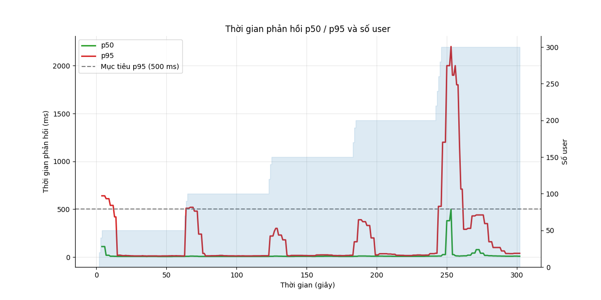
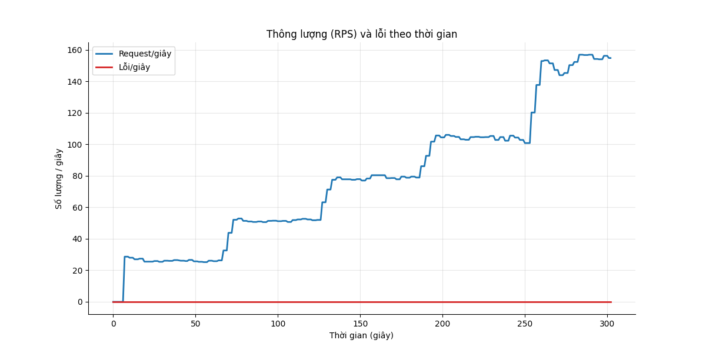
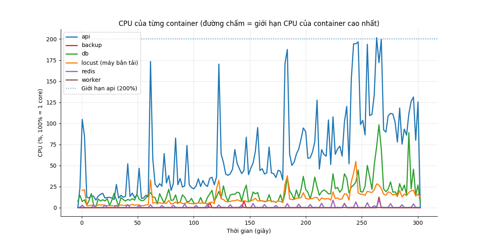
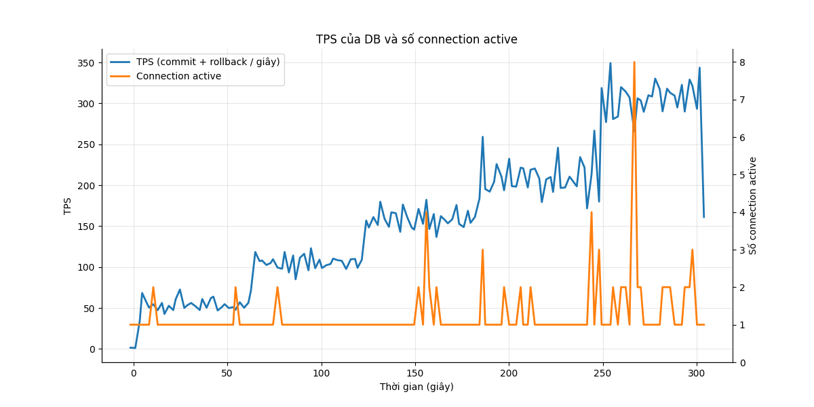

# Báo cáo load test: ramp (Tăng dần)

- Địa chỉ bắn: `http://api:8000`
- Thời điểm chạy: 2026-10-26T19:53:26Z (commit `4088646`)
- Tổng số request: 24.753, trung bình 82.3 request/giây
- RATE_LIMIT_ENABLED của api: `false`

## Mục tiêu so với thực tế

| Chỉ số | Mục tiêu | Thực tế | Kết quả |
|---|---|---|---|
| p95 thời gian phản hồi | < 500 ms | 270 ms | ĐẠT |
| Tỷ lệ lỗi | < 1% | 0.00% | ĐẠT |

**Kết luận: ĐẠT**

## Theo từng endpoint

| Endpoint | Số request | p50 (ms) | p95 (ms) | p99 (ms) | % lỗi |
|---|---|---|---|---|---|
| `POST /api/attendance/check` | 4695 | 10 | 190 | 510 | 0.00 |
| `POST /api/attendance/check (duplicate)` | 1496 | 7 | 150 | 500 | 0.00 |
| `GET /api/attendance/me` | 7832 | 8 | 250 | 840 | 0.00 |
| `POST /api/auth/login` | 300 | 580 | 2100 | 3100 | 0.00 |
| `GET /api/me` | 3239 | 5 | 180 | 600 | 0.00 |
| `POST /api/requests (create)` | 1650 | 11 | 200 | 780 | 0.00 |
| `POST /api/requests/[id]/approve` | 1163 | 13 | 170 | 580 | 0.00 |
| `GET /api/requests/me` | 3206 | 8 | 250 | 980 | 0.00 |
| `GET /api/requests?status=pending` | 1172 | 10 | 190 | 860 | 0.00 |
| **Tổng** | 24753 | 9 | 270 | 940 | 0.00 |

## CPU và RAM cao nhất

| Container | CPU cao nhất | Giới hạn CPU | RAM cao nhất | Giới hạn RAM |
|---|---|---|---|---|
| api | 202% | 200% | 369 MiB | 2048 MiB |
| backup | 13% | 50% | 3 MiB | 256 MiB |
| db | 98% | 100% | 213 MiB | 2048 MiB |
| locust (máy bắn tải) | 55% | 200% | 72 MiB | 1024 MiB |
| redis | 10% | 50% | 6 MiB | 256 MiB |
| worker | 1% | 100% | 60 MiB | 512 MiB |

**Điểm nghẽn:** **api** chạm giới hạn CPU (202% / 200%); **db** chạm giới hạn CPU (98% / 100%); **db** nghẽn ghi WAL (39% session chờ WALWrite/WALSync); **app** chậm hơn DB (37% session đang chạy chỉ chờ Client)

## TPS của DB

TPS trung bình 163, cao nhất 349; connection active cao nhất 8. Biểu đồ ở cuối báo cáo.

## DB đang chờ gì

Mỗi 2 giây đếm các session đang chạy theo wait event. Nhiều `Lock` nghĩa là tranh chấp khóa, `LWLock/WALWrite` nghĩa là nghẽn ghi WAL, `Client` nghĩa là app chậm.

| Wait event | Số lần thấy | Tỷ lệ | Ý nghĩa |
|---|---|---|---|
| `Client/ClientRead` | 14 | 36.8% | DB chờ app gửi/nhận (app chậm) |
| `IO/WALSync` | 12 | 31.6% | nghẽn ghi WAL (log giao dịch) |
| `CPU` | 9 | 23.7% | đang chạy CPU, không chờ gì |
| `LWLock/WALWrite` | 3 | 7.9% | nghẽn ghi WAL (log giao dịch) |

## Truy vấn tốn nhất

| Lần gọi | Trung bình (ms) | Tổng (ms) | Số dòng | Câu SQL |
|---|---|---|---|---|
| 6194 | 0.21 | 1271.6 | 4698 | `INSERT INTO attendance_events (employee_id, event_time, source, idempotency_key) VALUES ($1::BIGINT, now(), $2::VARCHAR,` |
| 4698 | 0.17 | 807.8 | 4698 | `INSERT INTO attendance_daily AS d (employee_id, work_date, first_in, last_out, worked_minutes, ot_minutes) SELECT CAST($` |
| 7835 | 0.06 | 488.2 | 7835 | `SELECT count(*) AS count_1 FROM attendance_daily WHERE attendance_daily.employee_id = $1::BIGINT` |
| 1651 | 0.28 | 463.2 | 1651 | `INSERT INTO requests (employee_id, type, work_date, start_at, end_at, reason) VALUES ($1::BIGINT, $2::VARCHAR, $3::DATE,` |
| 1172 | 0.38 | 444.6 | 1172 | `SELECT count(*) AS count_1 FROM requests WHERE requests.status = $1::VARCHAR AND requests.employee_id IN (SELECT employe` |
| 1172 | 0.37 | 436.7 | 21294 | `SELECT requests.id, requests.employee_id, requests.type, requests.work_date, requests.start_at, requests.end_at, request` |
| 7835 | 0.05 | 424.5 | 156700 | `SELECT attendance_daily.id, attendance_daily.employee_id, attendance_daily.work_date, attendance_daily.first_in, attenda` |
| 1162 | 0.26 | 306.7 | 1161 | `UPDATE requests SET status=$1::VARCHAR, approved_by=$2::BIGINT, decided_at=now() WHERE requests.id = $3::BIGINT AND requ` |
| 3207 | 0.06 | 182.4 | 13613 | `SELECT requests.id, requests.employee_id, requests.type, requests.work_date, requests.start_at, requests.end_at, request` |
| 4826 | 0.04 | 171.6 | 4826 | `SELECT employees.id, employees.code, employees.full_name, employees.department, employees.hired_on, employees.left_on, e` |
| 3207 | 0.05 | 145.7 | 3207 | `SELECT count(*) AS count_1 FROM requests WHERE requests.employee_id = $1::BIGINT` |
| 2813 | 0.05 | 138.2 | 2813 | `SELECT payroll_periods.status FROM payroll_periods WHERE payroll_periods.year = $1::INTEGER AND payroll_periods.month = ` |
| 1163 | 0.10 | 112.0 | 1163 | `SELECT requests.employee_id, requests.work_date, requests.status, requests.approved_by, requests.employee_id IN (SELECT ` |
| 49501 | 0.00 | 55.0 | 0 | `BEGIN` |
| 1496 | 0.03 | 48.3 | 1496 | `SELECT attendance_events.id, attendance_events.event_time, attendance_events.employee_id FROM attendance_events WHERE at` |

## Điểm gãy (ramp)

| Số user | p95 (ms) | % lỗi | RPS |
|---|---|---|---|
| 50 | 12 | 0.00 | 26.0 |
| 100 | 13 | 0.00 | 51.5 |
| 150 | 17 | 0.00 | 78.6 |
| 200 | 22 | 0.00 | 104.4 |
| 300 | 290 | 0.00 | 149.8 |
| 300 | 39 | 0.00 | 155.3 |

**Điểm gãy:** chưa gãy ở mức user cao nhất đã thử.

**RPS cao nhất vẫn đạt mục tiêu:** 155.3/giây (ở 300 user)

**Tự dừng:** không bậc nào vượt ngưỡng dừng, đã chạy hết các bậc.

## Biểu đồ

