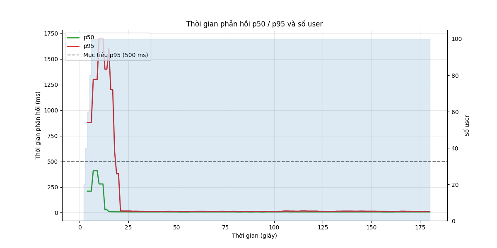
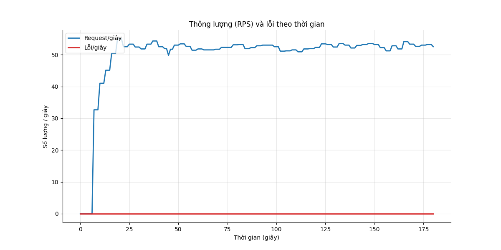
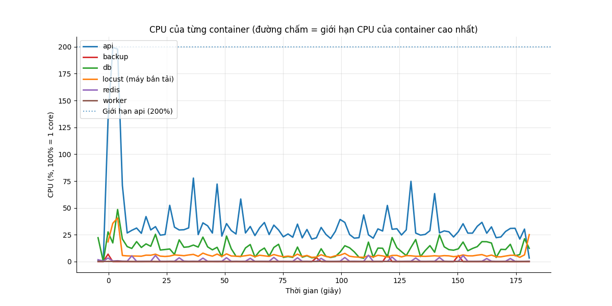
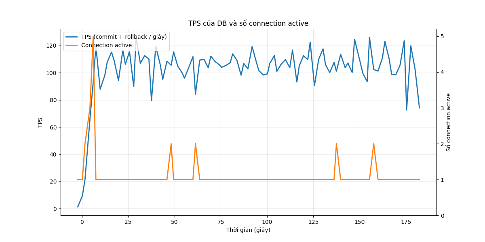

# Báo cáo load test: steady (Ổn định)

- Địa chỉ bắn: `http://api:8000`
- Thời điểm chạy: 2026-10-26T19:47:48Z (commit `4088646`)
- Tổng số request: 9.408, trung bình 52.1 request/giây
- RATE_LIMIT_ENABLED của api: `false`

## Mục tiêu so với thực tế

| Chỉ số | Mục tiêu | Thực tế | Kết quả |
|---|---|---|---|
| p95 thời gian phản hồi | < 500 ms | 16 ms | ĐẠT |
| Tỷ lệ lỗi | < 1% | 0.00% | ĐẠT |

**Kết luận: ĐẠT**

## Theo từng endpoint

| Endpoint | Số request | p50 (ms) | p95 (ms) | p99 (ms) | % lỗi |
|---|---|---|---|---|---|
| `POST /api/attendance/check` | 1839 | 8 | 16 | 290 | 0.00 |
| `POST /api/attendance/check (duplicate)` | 587 | 6 | 11 | 22 | 0.00 |
| `GET /api/attendance/me` | 2999 | 6 | 14 | 310 | 0.00 |
| `POST /api/auth/login` | 100 | 950 | 2100 | 2700 | 0.00 |
| `GET /api/me` | 1207 | 4 | 9 | 27 | 0.00 |
| `POST /api/requests (create)` | 614 | 9 | 18 | 310 | 0.00 |
| `POST /api/requests/[id]/approve` | 438 | 10 | 20 | 280 | 0.00 |
| `GET /api/requests/me` | 1186 | 6 | 15 | 390 | 0.00 |
| `GET /api/requests?status=pending` | 438 | 7 | 15 | 250 | 0.00 |
| **Tổng** | 9408 | 7 | 16 | 610 | 0.00 |

## CPU và RAM cao nhất

| Container | CPU cao nhất | Giới hạn CPU | RAM cao nhất | Giới hạn RAM |
|---|---|---|---|---|
| api | 199% | 200% | 357 MiB | 2048 MiB |
| backup | 7% | 50% | 7 MiB | 256 MiB |
| db | 49% | 100% | 154 MiB | 2048 MiB |
| locust (máy bắn tải) | 41% | 200% | 66 MiB | 1024 MiB |
| redis | 6% | 50% | 7 MiB | 256 MiB |
| worker | 0% | 100% | 60 MiB | 512 MiB |

**Điểm nghẽn:** **api** chạm giới hạn CPU (199% / 200%); **db** nghẽn ghi WAL (36% session chờ WALWrite/WALSync); **app** chậm hơn DB (45% session đang chạy chỉ chờ Client)

## TPS của DB

TPS trung bình 102, cao nhất 126; connection active cao nhất 5. Biểu đồ ở cuối báo cáo.

## DB đang chờ gì

Mỗi 2 giây đếm các session đang chạy theo wait event. Nhiều `Lock` nghĩa là tranh chấp khóa, `LWLock/WALWrite` nghĩa là nghẽn ghi WAL, `Client` nghĩa là app chậm.

| Wait event | Số lần thấy | Tỷ lệ | Ý nghĩa |
|---|---|---|---|
| `Client/ClientRead` | 5 | 45.5% | DB chờ app gửi/nhận (app chậm) |
| `IO/WALSync` | 4 | 36.4% | nghẽn ghi WAL (log giao dịch) |
| `CPU` | 2 | 18.2% | đang chạy CPU, không chờ gì |

## Truy vấn tốn nhất

| Lần gọi | Trung bình (ms) | Tổng (ms) | Số dòng | Câu SQL |
|---|---|---|---|---|
| 2427 | 0.14 | 345.6 | 1840 | `INSERT INTO attendance_events (employee_id, event_time, source, idempotency_key) VALUES ($1::BIGINT, now(), $2::VARCHAR,` |
| 1840 | 0.13 | 247.9 | 1840 | `INSERT INTO attendance_daily AS d (employee_id, work_date, first_in, last_out, worked_minutes, ot_minutes) SELECT CAST($` |
| 2999 | 0.05 | 156.2 | 2999 | `SELECT count(*) AS count_1 FROM attendance_daily WHERE attendance_daily.employee_id = $1::BIGINT` |
| 614 | 0.22 | 136.0 | 614 | `INSERT INTO requests (employee_id, type, work_date, start_at, end_at, reason) VALUES ($1::BIGINT, $2::VARCHAR, $3::DATE,` |
| 2999 | 0.04 | 116.3 | 59980 | `SELECT attendance_daily.id, attendance_daily.employee_id, attendance_daily.work_date, attendance_daily.first_in, attenda` |
| 438 | 0.23 | 98.8 | 7519 | `SELECT requests.id, requests.employee_id, requests.type, requests.work_date, requests.start_at, requests.end_at, request` |
| 438 | 0.20 | 86.7 | 438 | `UPDATE requests SET status=$1::VARCHAR, approved_by=$2::BIGINT, decided_at=now() WHERE requests.id = $3::BIGINT AND requ` |
| 438 | 0.17 | 75.3 | 438 | `SELECT count(*) AS count_1 FROM requests WHERE requests.status = $1::VARCHAR AND requests.employee_id IN (SELECT employe` |
| 1809 | 0.03 | 55.2 | 1809 | `SELECT employees.id, employees.code, employees.full_name, employees.department, employees.hired_on, employees.left_on, e` |
| 1186 | 0.04 | 47.8 | 4198 | `SELECT requests.id, requests.employee_id, requests.type, requests.work_date, requests.start_at, requests.end_at, request` |
| 1186 | 0.04 | 43.6 | 1186 | `SELECT count(*) AS count_1 FROM requests WHERE requests.employee_id = $1::BIGINT` |
| 1052 | 0.04 | 41.6 | 1052 | `SELECT payroll_periods.status FROM payroll_periods WHERE payroll_periods.year = $1::INTEGER AND payroll_periods.month = ` |
| 438 | 0.08 | 35.8 | 438 | `SELECT requests.employee_id, requests.work_date, requests.status, requests.approved_by, requests.employee_id IN (SELECT ` |
| 18813 | 0.00 | 21.6 | 0 | `BEGIN` |
| 15821 | 0.00 | 15.0 | 0 | `ROLLBACK` |

## Biểu đồ

