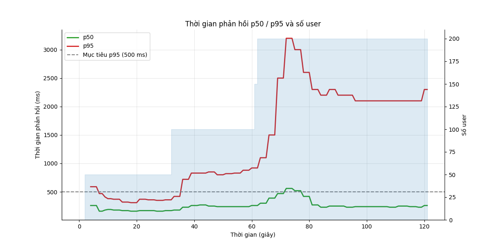
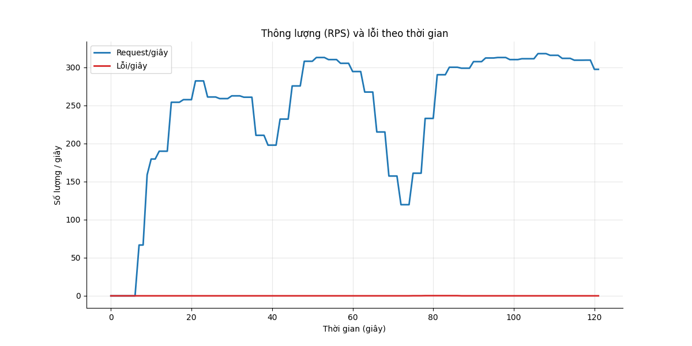
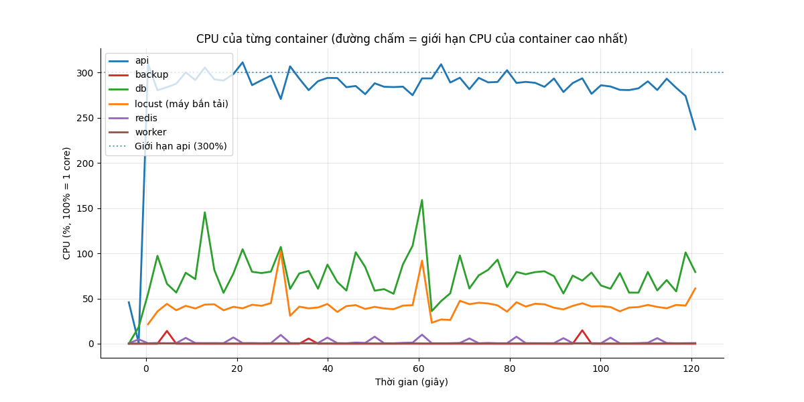
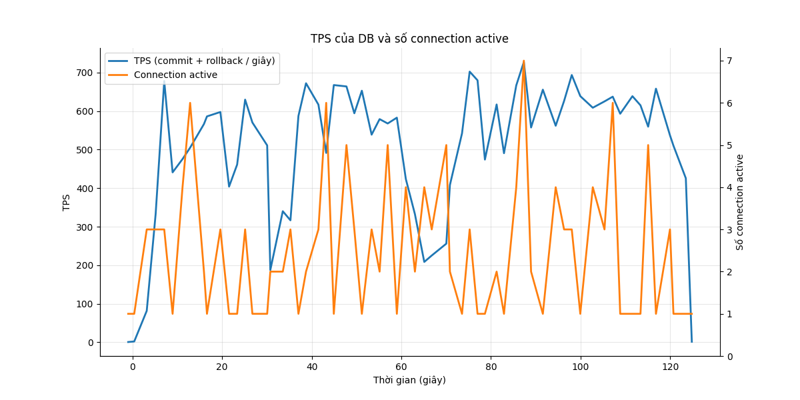

# Báo cáo load test: write_ramp (Ghi tăng dần)

- Địa chỉ bắn: `http://api:8000`
- Thời điểm chạy: 2026-10-26T20:11:53Z (commit `4088646`)
- Tổng số request: 32.278, trung bình 266.2 request/giây
- RATE_LIMIT_ENABLED của api: `false`

## Mục tiêu so với thực tế

| Chỉ số | Mục tiêu | Thực tế | Kết quả |
|---|---|---|---|
| p95 thời gian phản hồi | < 500 ms | 1700 ms | KHÔNG ĐẠT |
| Tỷ lệ lỗi | < 1% | 0.01% | ĐẠT |

**Kết luận: KHÔNG ĐẠT**

## Theo từng endpoint

| Endpoint | Số request | p50 (ms) | p95 (ms) | p99 (ms) | % lỗi |
|---|---|---|---|---|---|
| `POST /api/attendance/check` | 24144 | 210 | 1700 | 3100 | 0.00 |
| `POST /api/attendance/check (retry)` | 1 | 210 | 210 | 210 | 0.00 |
| `POST /api/requests (create)` | 8132 | 240 | 1800 | 3200 | 0.01 |
| `POST /api/requests (create) (retry)` | 1 | 210 | 210 | 210 | 0.00 |
| **Tổng** | 32278 | 210 | 1700 | 3100 | 0.01 |

Kết quả hợp lệ được đếm riêng (không tính là lỗi, không nằm trong tổng):

- login (not in totals): 200 lần

## CPU và RAM cao nhất

| Container | CPU cao nhất | Giới hạn CPU | RAM cao nhất | Giới hạn RAM |
|---|---|---|---|---|
| api | 311% | 300% | 365 MiB | 2048 MiB |
| backup | 15% | 50% | 6 MiB | 256 MiB |
| db | 159% | 200% | 194 MiB | 2048 MiB |
| locust (máy bắn tải) | 102% | 200% | 76 MiB | 1024 MiB |
| redis | 10% | 50% | 6 MiB | 256 MiB |
| worker | 0% | 100% | 61 MiB | 512 MiB |

**Điểm nghẽn:** **api** chạm giới hạn CPU (311% / 300%); **db** nghẽn ghi WAL (71% session chờ WALWrite/WALSync)

## TPS của DB

TPS trung bình 505, cao nhất 727; connection active cao nhất 7. Biểu đồ ở cuối báo cáo.

## DB đang chờ gì

Mỗi 2 giây đếm các session đang chạy theo wait event. Nhiều `Lock` nghĩa là tranh chấp khóa, `LWLock/WALWrite` nghĩa là nghẽn ghi WAL, `Client` nghĩa là app chậm.

| Wait event | Số lần thấy | Tỷ lệ | Ý nghĩa |
|---|---|---|---|
| `LWLock/WALWrite` | 38 | 40.4% | nghẽn ghi WAL (log giao dịch) |
| `IO/WALSync` | 29 | 30.9% | nghẽn ghi WAL (log giao dịch) |
| `Client/ClientRead` | 17 | 18.1% | DB chờ app gửi/nhận (app chậm) |
| `CPU` | 10 | 10.6% | đang chạy CPU, không chờ gì |

## Truy vấn tốn nhất

| Lần gọi | Trung bình (ms) | Tổng (ms) | Số dòng | Câu SQL |
|---|---|---|---|---|
| 24267 | 0.29 | 7017.5 | 24267 | `INSERT INTO attendance_events (employee_id, event_time, source, idempotency_key) VALUES ($1::BIGINT, now(), $2::VARCHAR,` |
| 24267 | 0.27 | 6524.0 | 24267 | `INSERT INTO attendance_daily AS d (employee_id, work_date, first_in, last_out, worked_minutes, ot_minutes) SELECT CAST($` |
| 8172 | 0.45 | 3636.7 | 8172 | `INSERT INTO requests (employee_id, type, work_date, start_at, end_at, reason, idempotency_key) VALUES ($1::BIGINT, $2::V` |
| 8172 | 0.09 | 747.1 | 8172 | `SELECT payroll_periods.status FROM payroll_periods WHERE payroll_periods.year = $1::INTEGER AND payroll_periods.month = ` |
| 8172 | 0.04 | 322.3 | 0 | `SELECT requests.id, requests.employee_id, requests.type, requests.work_date, requests.start_at, requests.end_at, request` |
| 65206 | 0.00 | 98.7 | 0 | `BEGIN` |
| 32639 | 0.00 | 70.2 | 0 | `COMMIT` |
| 32567 | 0.00 | 56.8 | 0 | `ROLLBACK` |
| 550 | 0.05 | 26.3 | 550 | `SELECT employees.id, employees.code, employees.full_name, employees.department, employees.hired_on, employees.left_on, e` |
| 200 | 0.07 | 13.6 | 200 | `SELECT employees.id, employees.code, employees.full_name, employees.department, employees.hired_on, employees.left_on, e` |
| 11 | 0.01 | 0.1 | 11 | `SELECT 1` |
| 1 | 0.01 | 0.0 | 1 | `SELECT now()` |

## Điểm gãy (ramp)

| Số user | p95 (ms) | % lỗi | RPS |
|---|---|---|---|
| 50 | 360 | 0.00 | 243.4 |
| 100 | 830 | 0.00 | 281.2 |
| 200 | 2500 | 0.05 | 226.0 |
| 200 (giữ thêm sau khi gãy) | 2100 | 0.00 | 312.3 |
| 200 (giữ thêm sau khi gãy) | 2300 | 0.00 | 297.2 |

**Điểm gãy:** 100 user (p95 830 ms, lỗi 0.00%)

**RPS ghi cao nhất vẫn đạt mục tiêu:** 243.4/giây (ở 50 user)

**Tự dừng:** dừng ở bậc 3 (200 user): p95 2200 ms > 1000 ms; giữ tải thêm 30 giây để thu số liệu.

## Biểu đồ

## Đối soát ghi (không mất, không trùng)

| Chỉ số | Số lượng | Kết quả |
|---|---|---|
| Tổng lệnh ghi đã gửi (attendance: 24144, request: 8132) | 32276 | |
| Được xác nhận (2xx) | 32276 | |
| **Đã xác nhận nhưng không có trong DB** | 0 | ĐẠT |
| Key bị trùng trong DB | 0 | ĐẠT |
| Lỗi sau khi hết retry | 0 | |
| Trong số lỗi, thực ra đã vào DB (commit nhưng client không nhận được trả lời) | 0 | |
| Lệnh phải retry ít nhất một lần | 2 | |
| Key trong DB không có trong writes.jsonl (thường là lệnh đang bay lúc test dừng, hoặc traffic khác) | 163 | |
