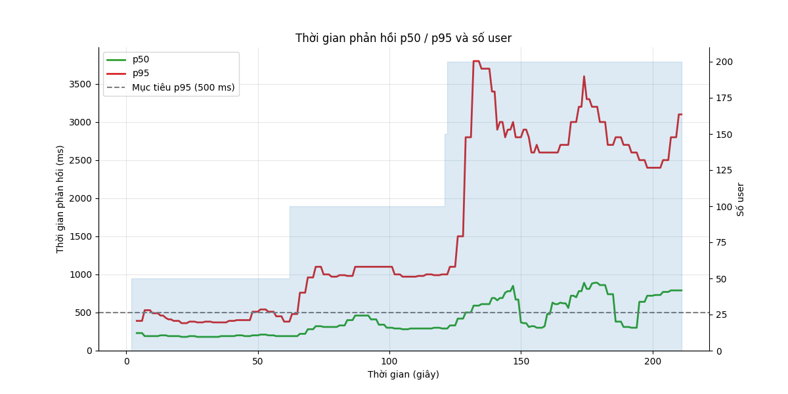
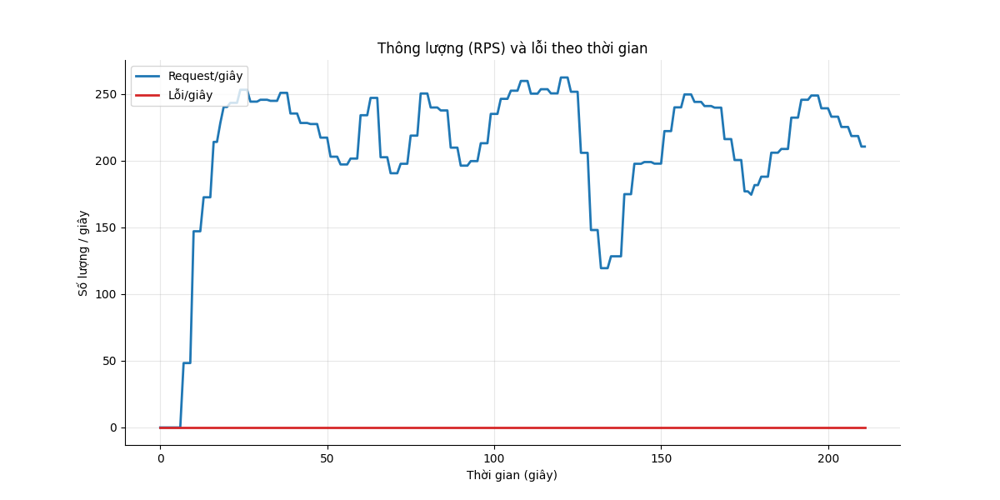
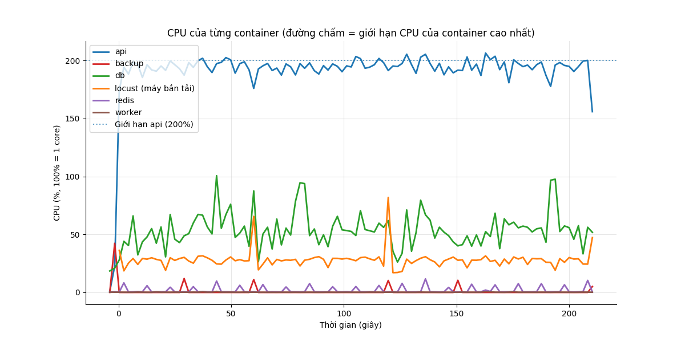
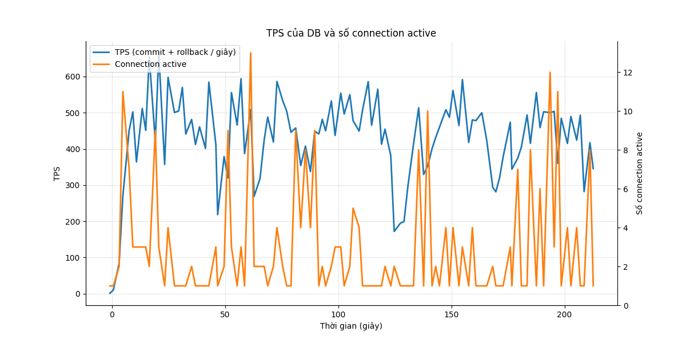

# Báo cáo load test: write_ramp (Ghi tăng dần)

- Địa chỉ bắn: `http://api:8000`
- Thời điểm chạy: 2026-10-26T20:02:25Z (commit `4088646`)
- Tổng số request: 46.119, trung bình 219.1 request/giây
- RATE_LIMIT_ENABLED của api: `false`

## Mục tiêu so với thực tế

| Chỉ số | Mục tiêu | Thực tế | Kết quả |
|---|---|---|---|
| p95 thời gian phản hồi | < 500 ms | 2000 ms | KHÔNG ĐẠT |
| Tỷ lệ lỗi | < 1% | 0.00% | ĐẠT |

**Kết luận: KHÔNG ĐẠT**

## Theo từng endpoint

| Endpoint | Số request | p50 (ms) | p95 (ms) | p99 (ms) | % lỗi |
|---|---|---|---|---|---|
| `POST /api/attendance/check` | 34518 | 250 | 2000 | 3600 | 0.00 |
| `POST /api/requests (create)` | 11601 | 280 | 2000 | 3600 | 0.00 |
| **Tổng** | 46119 | 260 | 2000 | 3600 | 0.00 |

Kết quả hợp lệ được đếm riêng (không tính là lỗi, không nằm trong tổng):

- login (not in totals): 200 lần

## CPU và RAM cao nhất

| Container | CPU cao nhất | Giới hạn CPU | RAM cao nhất | Giới hạn RAM |
|---|---|---|---|---|
| api | 207% | 200% | 370 MiB | 2048 MiB |
| backup | 42% | 50% | 6 MiB | 256 MiB |
| db | 101% | 100% | 218 MiB | 2048 MiB |
| locust (máy bắn tải) | 82% | 200% | 76 MiB | 1024 MiB |
| redis | 12% | 50% | 6 MiB | 256 MiB |
| worker | 1% | 100% | 60 MiB | 512 MiB |

**Điểm nghẽn:** **api** chạm giới hạn CPU (207% / 200%); **db** chạm giới hạn CPU (101% / 100%); **db** nghẽn ghi WAL (78% session chờ WALWrite/WALSync)

## TPS của DB

TPS trung bình 430, cao nhất 665; connection active cao nhất 13. Biểu đồ ở cuối báo cáo.

## DB đang chờ gì

Mỗi 2 giây đếm các session đang chạy theo wait event. Nhiều `Lock` nghĩa là tranh chấp khóa, `LWLock/WALWrite` nghĩa là nghẽn ghi WAL, `Client` nghĩa là app chậm.

| Wait event | Số lần thấy | Tỷ lệ | Ý nghĩa |
|---|---|---|---|
| `LWLock/WALWrite` | 118 | 57.6% | nghẽn ghi WAL (log giao dịch) |
| `IO/WALSync` | 41 | 20.0% | nghẽn ghi WAL (log giao dịch) |
| `Client/ClientRead` | 27 | 13.2% | DB chờ app gửi/nhận (app chậm) |
| `CPU` | 18 | 8.8% | đang chạy CPU, không chờ gì |
| `IO/WALWrite` | 1 | 0.5% | nghẽn ghi WAL (log giao dịch) |

## Truy vấn tốn nhất

| Lần gọi | Trung bình (ms) | Tổng (ms) | Số dòng | Câu SQL |
|---|---|---|---|---|
| 34660 | 0.28 | 9605.8 | 34660 | `INSERT INTO attendance_events (employee_id, event_time, source, idempotency_key) VALUES ($1::BIGINT, now(), $2::VARCHAR,` |
| 34660 | 0.25 | 8685.2 | 34660 | `INSERT INTO attendance_daily AS d (employee_id, work_date, first_in, last_out, worked_minutes, ot_minutes) SELECT CAST($` |
| 11636 | 0.45 | 5234.6 | 11636 | `INSERT INTO requests (employee_id, type, work_date, start_at, end_at, reason, idempotency_key) VALUES ($1::BIGINT, $2::V` |
| 11636 | 0.08 | 936.4 | 11636 | `SELECT payroll_periods.status FROM payroll_periods WHERE payroll_periods.year = $1::INTEGER AND payroll_periods.month = ` |
| 11636 | 0.03 | 404.9 | 0 | `SELECT requests.id, requests.employee_id, requests.type, requests.work_date, requests.start_at, requests.end_at, request` |
| 92956 | 0.00 | 181.9 | 0 | `BEGIN` |
| 1 | 99.67 | 99.7 | 45422 | `COPY public.attendance_events (id, employee_id, event_time, source, idempotency_key, created_at) TO stdout` |
| 900 | 0.08 | 71.3 | 900 | `SELECT employees.id, employees.code, employees.full_name, employees.department, employees.hired_on, employees.left_on, e` |
| 46496 | 0.00 | 67.6 | 0 | `COMMIT` |
| 46459 | 0.00 | 59.4 | 0 | `ROLLBACK` |
| 1 | 36.99 | 37.0 | 22711 | `COPY public.attendance_daily (id, employee_id, work_date, first_in, last_out, worked_minutes, ot_minutes) TO stdout` |
| 1 | 32.60 | 32.6 | 23700 | `COPY public.schedules (id, employee_id, work_date, shift_id) TO stdout` |
| 1 | 12.69 | 12.7 | 5252 | `SELECT description, classoid, objoid, objsubid FROM pg_catalog.pg_description ORDER BY classoid, objoid, objsubid` |
| 200 | 0.05 | 10.4 | 200 | `SELECT employees.id, employees.code, employees.full_name, employees.department, employees.hired_on, employees.left_on, e` |
| 1 | 5.73 | 5.7 | 15 | `SELECT p.tableoid, p.oid, p.proname, p.prolang, p.pronargs, p.proargtypes, p.prorettype, p.proacl, acldefault($1, p.proo` |

## Điểm gãy (ramp)

| Số user | p95 (ms) | % lỗi | RPS |
|---|---|---|---|
| 50 | 390 | 0.00 | 228.7 |
| 100 | 1000 | 0.00 | 234.4 |
| 200 | 2900 | 0.00 | 208.0 |
| 200 (giữ thêm sau khi gãy) | 2500 | 0.00 | 230.5 |

**Điểm gãy:** 100 user (p95 1000 ms, lỗi 0.00%)

**RPS ghi cao nhất vẫn đạt mục tiêu:** 228.7/giây (ở 50 user)

**Tự dừng:** dừng ở bậc 3 (200 user): p95 3000 ms > 1000 ms; giữ tải thêm 30 giây để thu số liệu.

## Biểu đồ

## Đối soát ghi (không mất, không trùng)

| Chỉ số | Số lượng | Kết quả |
|---|---|---|
| Tổng lệnh ghi đã gửi (attendance: 34518, request: 11601) | 46119 | |
| Được xác nhận (2xx) | 46119 | |
| **Đã xác nhận nhưng không có trong DB** | 0 | ĐẠT |
| Key bị trùng trong DB | 0 | ĐẠT |
| Lỗi sau khi hết retry | 0 | |
| Trong số lỗi, thực ra đã vào DB (commit nhưng client không nhận được trả lời) | 0 | |
| Lệnh phải retry ít nhất một lần | 0 | |
| Key trong DB không có trong writes.jsonl (thường là lệnh đang bay lúc test dừng, hoặc traffic khác) | 177 | |
