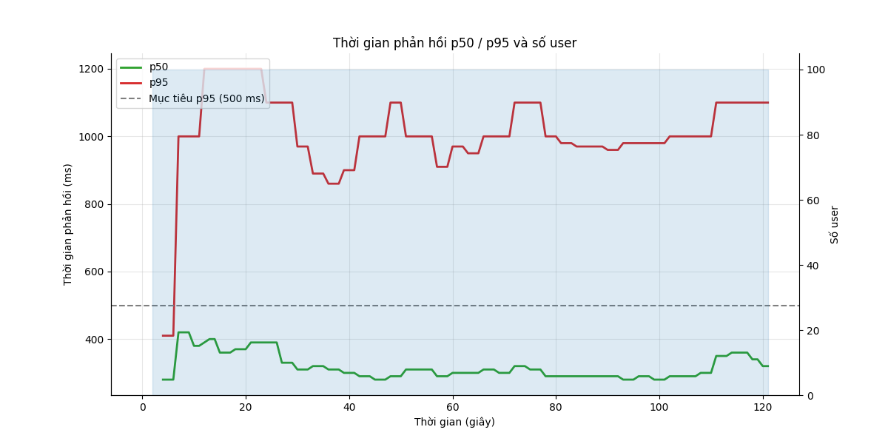
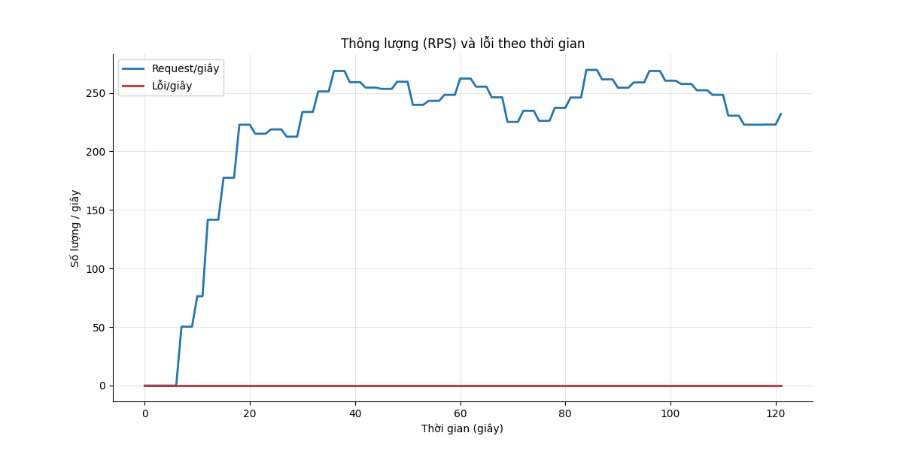
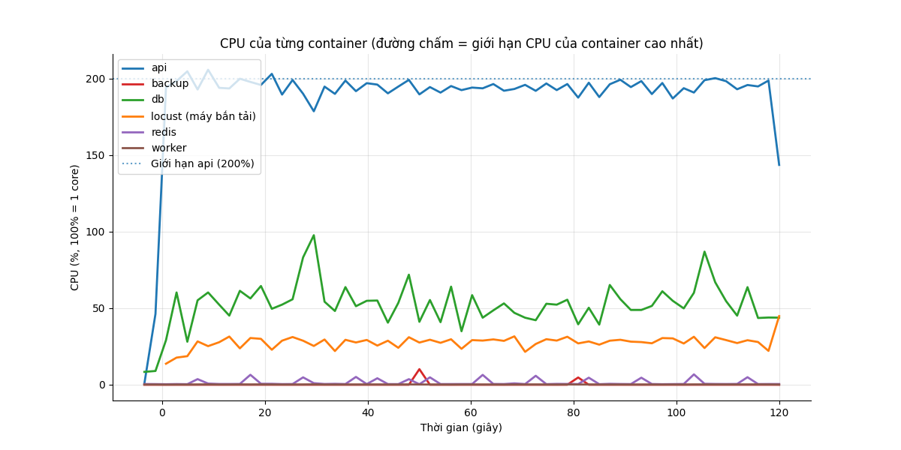
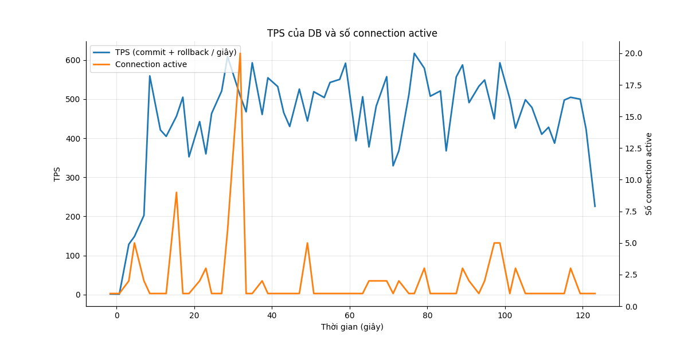

# Báo cáo load test: write_storm (Ghi dồn dập)

- Địa chỉ bắn: `http://api:8000`
- Thời điểm chạy: 2026-10-26T20:00:03Z (commit `4088646`)
- Tổng số request: 28.348, trung bình 235.7 request/giây
- RATE_LIMIT_ENABLED của api: `false`

## Mục tiêu so với thực tế

| Chỉ số | Mục tiêu | Thực tế | Kết quả |
|---|---|---|---|
| p95 thời gian phản hồi | < 500 ms | 1000 ms | KHÔNG ĐẠT |
| Tỷ lệ lỗi | < 1% | 0.00% | ĐẠT |

**Kết luận: KHÔNG ĐẠT**

## Theo từng endpoint

| Endpoint | Số request | p50 (ms) | p95 (ms) | p99 (ms) | % lỗi |
|---|---|---|---|---|---|
| `POST /api/attendance/check` | 21205 | 300 | 1000 | 1600 | 0.00 |
| `POST /api/requests (create)` | 7143 | 330 | 1000 | 1600 | 0.00 |
| **Tổng** | 28348 | 310 | 1000 | 1600 | 0.00 |

Kết quả hợp lệ được đếm riêng (không tính là lỗi, không nằm trong tổng):

- login (not in totals): 100 lần

## CPU và RAM cao nhất

| Container | CPU cao nhất | Giới hạn CPU | RAM cao nhất | Giới hạn RAM |
|---|---|---|---|---|
| api | 206% | 200% | 368 MiB | 2048 MiB |
| backup | 10% | 50% | 3 MiB | 256 MiB |
| db | 98% | 100% | 219 MiB | 2048 MiB |
| locust (máy bắn tải) | 45% | 200% | 72 MiB | 1024 MiB |
| redis | 7% | 50% | 8 MiB | 256 MiB |
| worker | 0% | 100% | 60 MiB | 512 MiB |

**Điểm nghẽn:** **api** chạm giới hạn CPU (206% / 200%); **db** chạm giới hạn CPU (98% / 100%); **db** nghẽn ghi WAL (81% session chờ WALWrite/WALSync)

## TPS của DB

TPS trung bình 451, cao nhất 617; connection active cao nhất 20. Biểu đồ ở cuối báo cáo.

## DB đang chờ gì

Mỗi 2 giây đếm các session đang chạy theo wait event. Nhiều `Lock` nghĩa là tranh chấp khóa, `LWLock/WALWrite` nghĩa là nghẽn ghi WAL, `Client` nghĩa là app chậm.

| Wait event | Số lần thấy | Tỷ lệ | Ý nghĩa |
|---|---|---|---|
| `LWLock/WALWrite` | 35 | 51.5% | nghẽn ghi WAL (log giao dịch) |
| `IO/WALSync` | 17 | 25.0% | nghẽn ghi WAL (log giao dịch) |
| `Client/ClientRead` | 11 | 16.2% | DB chờ app gửi/nhận (app chậm) |
| `LWLock/WALInsert` | 3 | 4.4% | nghẽn ghi WAL (log giao dịch) |
| `CPU` | 2 | 2.9% | đang chạy CPU, không chờ gì |

## Truy vấn tốn nhất

| Lần gọi | Trung bình (ms) | Tổng (ms) | Số dòng | Câu SQL |
|---|---|---|---|---|
| 21263 | 0.24 | 5046.0 | 21263 | `INSERT INTO attendance_events (employee_id, event_time, source, idempotency_key) VALUES ($1::BIGINT, now(), $2::VARCHAR,` |
| 21263 | 0.22 | 4741.2 | 21263 | `INSERT INTO attendance_daily AS d (employee_id, work_date, first_in, last_out, worked_minutes, ot_minutes) SELECT CAST($` |
| 7159 | 0.39 | 2758.5 | 7159 | `INSERT INTO requests (employee_id, type, work_date, start_at, end_at, reason, idempotency_key) VALUES ($1::BIGINT, $2::V` |
| 7159 | 0.08 | 596.7 | 7159 | `SELECT payroll_periods.status FROM payroll_periods WHERE payroll_periods.year = $1::INTEGER AND payroll_periods.month = ` |
| 7159 | 0.03 | 205.9 | 0 | `SELECT requests.id, requests.employee_id, requests.type, requests.work_date, requests.start_at, requests.end_at, request` |
| 57043 | 0.00 | 70.1 | 0 | `BEGIN` |
| 28522 | 0.00 | 40.8 | 0 | `COMMIT` |
| 28521 | 0.00 | 34.0 | 0 | `ROLLBACK` |
| 400 | 0.03 | 12.7 | 400 | `SELECT employees.id, employees.code, employees.full_name, employees.department, employees.hired_on, employees.left_on, e` |
| 100 | 0.04 | 3.7 | 100 | `SELECT employees.id, employees.code, employees.full_name, employees.department, employees.hired_on, employees.left_on, e` |
| 11 | 0.00 | 0.0 | 11 | `SELECT $1` |
| 1 | 0.01 | 0.0 | 1 | `SELECT now()` |

## Biểu đồ

## Đối soát ghi (không mất, không trùng)

| Chỉ số | Số lượng | Kết quả |
|---|---|---|
| Tổng lệnh ghi đã gửi (attendance: 21205, request: 7143) | 28348 | |
| Được xác nhận (2xx) | 28348 | |
| **Đã xác nhận nhưng không có trong DB** | 0 | ĐẠT |
| Key bị trùng trong DB | 0 | ĐẠT |
| Lỗi sau khi hết retry | 0 | |
| Trong số lỗi, thực ra đã vào DB (commit nhưng client không nhận được trả lời) | 0 | |
| Lệnh phải retry ít nhất một lần | 0 | |
| Key trong DB không có trong writes.jsonl (thường là lệnh đang bay lúc test dừng, hoặc traffic khác) | 74 | |
