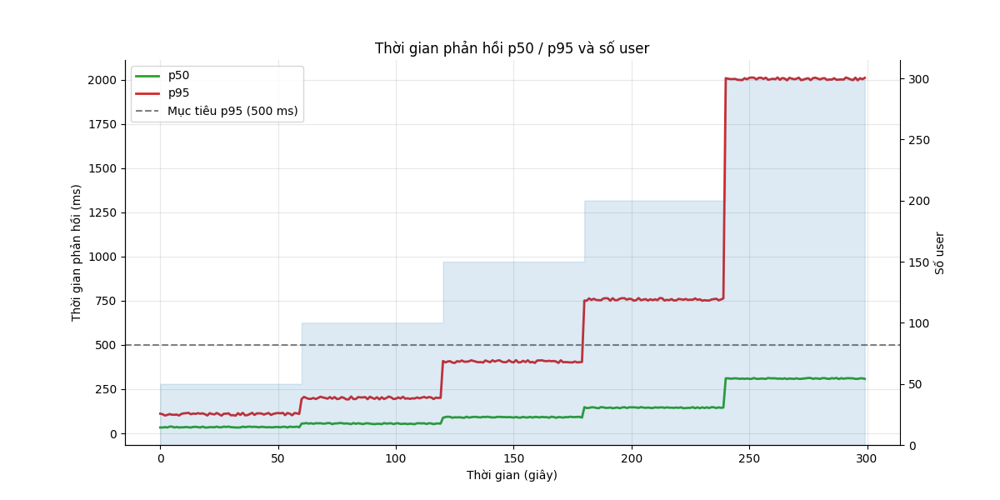
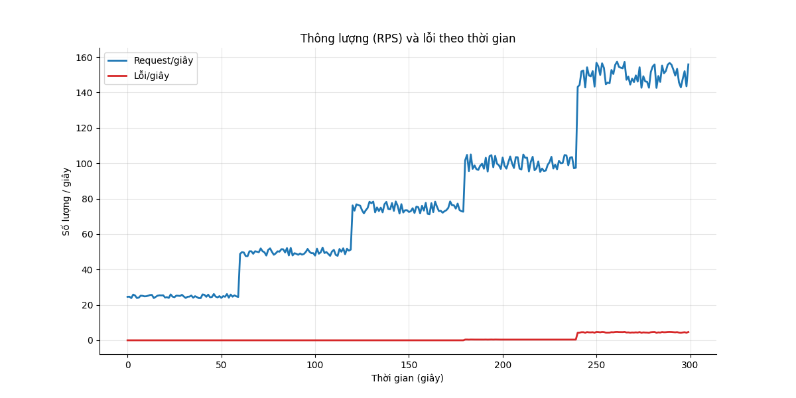
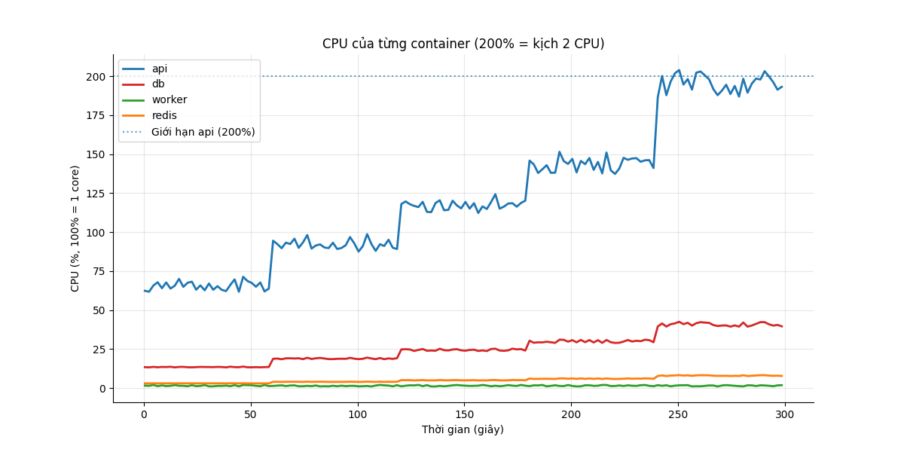

# Báo cáo load test: ramp (Tăng dần)

- Địa chỉ bắn: `http://api:8000`
- Thời điểm chạy: SAMPLE (fake data) (commit `0000000`)
- Tổng số request: 23.797, trung bình 79.3 request/giây

## Mục tiêu so với thực tế

| Chỉ số | Mục tiêu | Thực tế | Kết quả |
|---|---|---|---|
| p95 thời gian phản hồi | < 500 ms | 230 ms | ĐẠT |
| Tỷ lệ lỗi | < 1% | 1.01% | KHÔNG ĐẠT |

**Kết luận: KHÔNG ĐẠT**

## Theo từng endpoint

| Endpoint | Số request | p50 (ms) | p95 (ms) | p99 (ms) | % lỗi |
|---|---|---|---|---|---|
| `POST /api/auth/login` | 237 | 40 | 190 | 266 | 0.84 |
| `POST /api/attendance/check` | 5949 | 40 | 190 | 266 | 1.01 |
| `GET /api/attendance/me` | 7853 | 40 | 190 | 266 | 1.01 |
| `GET /api/me` | 3331 | 40 | 190 | 266 | 0.99 |
| `GET /api/requests/me` | 3331 | 40 | 190 | 266 | 0.99 |
| `POST /api/requests (create)` | 1427 | 40 | 190 | 266 | 0.98 |
| `GET /api/requests?status=pending` | 713 | 40 | 190 | 266 | 0.98 |
| `POST /api/requests/[id]/approve` | 951 | 40 | 190 | 266 | 0.95 |
| **Tổng** | 23797 | 42 | 230 | 322 | 1.01 |

Kết quả hợp lệ được đếm riêng (không tính là lỗi, không nằm trong tổng):

- approve 409 (contention): 37 lần

## CPU và RAM cao nhất

| Container | CPU cao nhất | Giới hạn CPU | RAM cao nhất | Giới hạn RAM |
|---|---|---|---|---|
| api | 204% | 200% | 360 MiB | 2048 MiB |
| db | 42% | 100% | 1060 MiB | 2048 MiB |
| worker | 2% | 100% | 90 MiB | 512 MiB |
| redis | 8% | 50% | 12 MiB | 256 MiB |

**Điểm nghẽn:** **api** chạm giới hạn CPU (204% / 200%)

## Điểm gãy (ramp)

| Số user | p95 (ms) | % lỗi | RPS |
|---|---|---|---|
| 50 | 111 | 0.00 | 24.8 |
| 100 | 200 | 0.00 | 49.9 |
| 150 | 404 | 0.00 | 74.5 |
| 200 | 756 | 0.40 | 99.9 |
| 300 | 2005 | 3.00 | 150.0 |

**Điểm gãy:** 200 user (p95 756 ms, lỗi 0.40%)

## Biểu đồ

